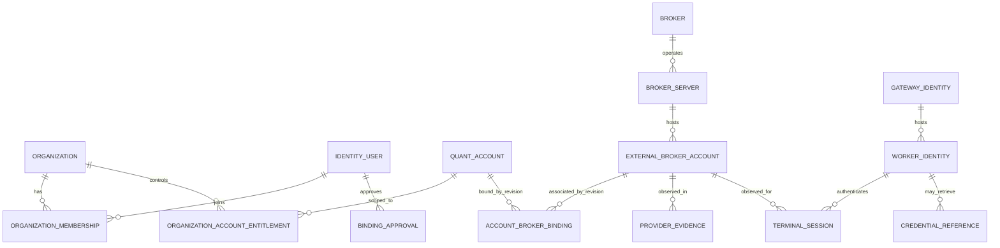
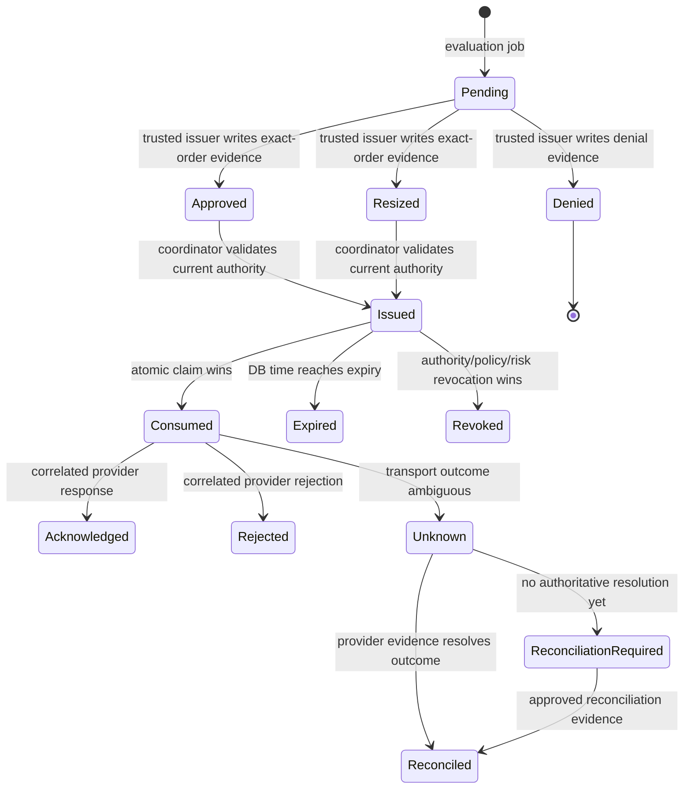
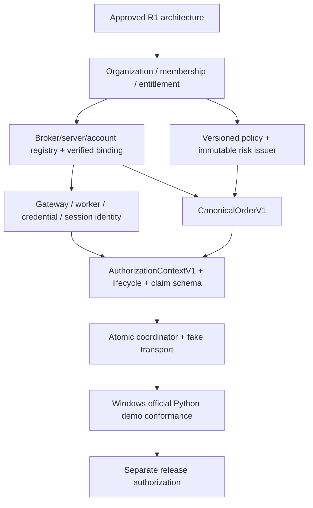

# QOS-021A-E3A-R1 — Architecture Decision Resolution

**Final status: COMPLETE — architecture decisions recorded; implementation is not authorized.**
**Repository:** `/Users/olaoluwatunmise/event-driven-trading-rs`
**Branch / HEAD:** `main` / `f6446dd33dc74a86ede9064f35aef2ec082a1c59`
**Authority:** QOS-021A-E3A-R1 approved decisions in the task directive.
**Files changed in this phase:** only this new documentation file.

## 1. Resolution summary

This document resolves the six E3A recommendations using the approved product and security decisions in the R1 directive. The architecture is now the contract for a later implementation plan:

- Organizations are the SaaS customer/tenant boundary; individual users join organizations with scoped roles.
- Broker, broker server, external broker account, internal Quant account, and their versioned binding are separate identities. Existing `venues` remains an execution routing/capability concept, not the broker registry.
- Verified account binding requires provider evidence **and** administrator approval. These prove different things: authenticated provider metadata establishes account information/control at a connection, while an approved verification process establishes an authorized association; neither terminal heartbeat nor dashboard access proves legal ownership.
- Official MetaTrader5 Python integration on managed Windows gateways is the preferred production provider, subject to Windows demo-conformance evidence. macOS is development/conformance only. The MQL5 socket provider is a development/conformance adapter and not a simultaneous production provider or silent fallback.
- A trusted risk issuer creates an immutable decision for one exact `CanonicalOrderV1`, with policy/input evidence and all relevant authority revisions. Risk facts and their mutable lifecycle are separate.
- Canonical order digest and `AuthorizationContextV1` are different objects and have separate encodings/digests. An authorization binds the canonical order to current tenant/account/broker/environment/workload/risk authority, expiry, nonce and durable claim.
- Authorization consumption is atomic and single-use. Claim/authorization state is committed before transport I/O. A timeout or ambiguous result becomes unknown/reconciliation-required; no blind retry and no exactly-once claim.
- Any relevant authority or policy revision invalidates every **unconsumed** authorization. Once consumed, the record is retained and is not rewritten as though submission did not occur.

**Implementation remains blocked from execution by scope:** this phase creates architecture documentation only. MT5 deny-all behavior, the E1-R1 sealed simulation-only boundary, and QOS-020 resource/endpoint guards remain unchanged.

## 2. Preflight and preservation evidence

### 2.1 Repository identity

Commands and actual outputs:

```text
$ pwd
/Users/olaoluwatunmise/event-driven-trading-rs

$ git rev-parse --show-toplevel
/Users/olaoluwatunmise/event-driven-trading-rs

$ git branch --show-current
main

$ git rev-parse HEAD
f6446dd33dc74a86ede9064f35aef2ec082a1c59
```

The active root, branch and HEAD matched the R1 directive.

### 2.2 Baseline worktree

Before writing this report, `git status --porcelain=v1 --untracked-files=all` showed these existing changes (two-column porcelain distinguishes staged/unstaged status):

```text
 M .github/workflows/ci.yml
M  Cargo.lock
 M crates/account-engine/src/simulated.rs
 M crates/domain/src/account.rs
 M crates/domain/src/lib.rs
 M crates/domain/tests/phase1_architecture.rs
 M crates/event-trading/src/execution/fill.rs
 M crates/execution-engine/src/oms.rs
 M crates/intent-bridge/src/lib.rs
 M crates/intent-bridge/src/mt5_runtime.rs
 M crates/intent-bridge/src/mt5_transport.rs
 M crates/intent-bridge/src/mt5_v1.rs
 M crates/intent-bridge/tests/mt5_transport_mtls.rs
 M crates/journal-api/src/dashboard.rs
 M crates/persistence/src/pool.rs
 M crates/persistence/src/repos/accounts.rs
 M crates/persistence/src/repos/mod.rs
 M crates/persistence/tests/survive_restart.rs
 M crates/reconciliation/tests/venue_vs_internal.rs
 M crates/trading-runtime/src/multi_account.rs
 M crates/trading-runtime/src/pipeline.rs
 M crates/trading-runtime/src/runtime.rs
 M crates/venue-connectors/src/adapter.rs
 M crates/venue-connectors/src/bridge.rs
 M crates/venue-connectors/src/lib.rs
 M crates/venue-connectors/src/prop.rs
 M crates/venue-connectors/src/simulated.rs
 D crates/venue-connectors/tests/ambiguous_unknown.rs
 D crates/venue-connectors/tests/cancel_confirmation.rs
 M crates/venue-connectors/tests/e2e_pipeline.rs
 D crates/venue-connectors/tests/failure_injection.rs
 M crates/venue-connectors/tests/prop_pipeline.rs
M  docker-compose.yml
?? crates/domain/src/execution_authorization.rs
?? crates/persistence/tests/qos021a_e2_migrations.rs
?? crates/venue-connectors/src/tests/ambiguous_unknown.rs
?? crates/venue-connectors/src/tests/cancel_confirmation.rs
?? crates/venue-connectors/src/tests/failure_injection.rs
?? docs/QOS-020_TEST_INFRASTRUCTURE.md
?? docs/QOS-021A-E1-R1_GENERIC_VENUE_EXECUTION_BOUNDARY.md
?? docs/QOS-021A-E1_EXECUTION_AUTHORIZATION_FOUNDATION.md
?? docs/QOS-021A-E2_ACCOUNT_ENVIRONMENT_AND_MIGRATION_FOUNDATION.md
?? docs/QOS-021A-E3A_TRUSTED_IDENTITY_AND_IMMUTABLE_RISK_ARCHITECTURE.md
?? docs/QOS-021A-S_ARCHITECTURE_AND_INFRASTRUCTURE_RECOVERY.md
?? migrations/20261111000001_journal_trading_account_fk_repair.sql
?? migrations/20261111000002_account_environment_provenance.sql
?? migrations/20261111000003_execution_authorizations_and_claims.sql
?? scripts/qos020/docker-compose.qos020.yml
?? scripts/qos020/init/10-qos020-init.sql
?? scripts/qos020/provision.py
?? scripts/qos020/qos020_guard.py
?? scripts/qos020/test_guard.py
?? scripts/traderos-migration/migrate.py.before-http-debug
?? scripts/traderos-migration/migrate.py.debug-backup
```

Pre-existing ignored state recorded by `git status --short --ignored`:

```text
!! .conda/
!! .pytest_cache/
!! .venv/
!! .vscode/
!! adapters/mt5-python/.pytest_cache/
!! adapters/mt5-python/mt5_adapter/__pycache__/
!! adapters/mt5-python/quant_os_mt5_readonly_adapter.egg-info/
!! adapters/mt5-python/scripts/__pycache__/
!! adapters/mt5-python/tests/__pycache__/
!! frontend/.next/
!! frontend/.open-next/
!! frontend/.wrangler/
!! frontend/next-env.d.ts
!! frontend/node_modules/
!! frontend/tsconfig.tsbuildinfo
!! migration-report.json
!! migration-state.json
!! migration/
!! scripts/__pycache__/
!! scripts/qos020/__pycache__/
!! scripts/traderos-migration/__pycache__/
!! strategies/python/trading_strategies.egg-info/
!! target/
```

No existing work was staged, unstaged, reset, cleaned, stashed, checked out, removed, overwritten or otherwise changed. Existing deleted test paths were already deleted at preflight and were preserved as-is.

### 2.3 Protected hashes captured before writing

`shasum -a 256` output:

| Protected artifact | SHA-256 |
|---|---|
| `Cargo.lock` | `0114a3432961bae1989c479073e12ea84df6507c27debda84e832d950e35e0a0` |
| `docker-compose.yml` | `0a761eb4c42c5d9b72cd9f642ea7ef8411fc70106205b2acbcb2e90ef4789866` |
| `.github/workflows/ci.yml` | `7eb6c98d3518e05e97497f2e8ec1163d6ca90488556af870098f3cd2cbcbd1f6` |
| `crates/intent-bridge/src/mt5_v1.rs` | `514c6bd0b7da5846e558dfc6e221e1e5192472e4b359f7200d493f67dbeddcb2` |
| `docs/QOS-021A-E3A_TRUSTED_IDENTITY_AND_IMMUTABLE_RISK_ARCHITECTURE.md` | `a590dc9e7e7cfb55bbbe282a919b97b6a10f76e5a6f29960e024cc30f3cd1178` |
| `docs/QOS-021A-E2_ACCOUNT_ENVIRONMENT_AND_MIGRATION_FOUNDATION.md` | `fa74519d8b361b1920d4de054b8508da269001428b7950897a17b424381c9639` |
| `docs/QOS-021A-E1_EXECUTION_AUTHORIZATION_FOUNDATION.md` | `de5e24235d0958d322330d9fde2f76fa193b9a9fcfa560ade0dc75b166a7f44d` |
| `docs/QOS-021A-E1-R1_GENERIC_VENUE_EXECUTION_BOUNDARY.md` | `ee69148e712870d791b11f3f7854cb56785dc40ba994adb1c97f8f7559a9d214` |
| `docs/QOS-020_TEST_INFRASTRUCTURE.md` | `a439e0ca37f4d863a381c523bf3b3ba3548a2eab0d678b0e947a3b946a167bbb` |
| `docs/QOS-021A-S_ARCHITECTURE_AND_INFRASTRUCTURE_RECOVERY.md` | `7e7b0961509be76ac455e299b878d5f4dffdec8f5a40bc5f927e556bb702dada` |
| `scripts/traderos-migration/migrate.py.before-http-debug` | `3156c8bb1c26ea24baa9a3eaaa35426753d350ce61f3d1801950a41a36b402a` |
| `scripts/traderos-migration/migrate.py.debug-backup` | `3156c8bb1c26ea24baa9a3eaaa35426753d350ce61f3d1801950a41a36b402a` |

Both migration backup files have the same SHA-256 digest, as shown by the exact preflight command output. They were not read or changed in this phase.

### 2.4 Existing architecture and ADR convention

The full E3A report was located and read at `docs/QOS-021A-E3A_TRUSTED_IDENTITY_AND_IMMUTABLE_RISK_ARCHITECTURE.md`. It identifies the current gaps in broker identity, tenant model, decision immutability, canonical order binding, consumption and invalidation.

The repository has no separate `docs/adr/` directory, ADR index, or existing `ADR-*` file (`rg --files docs | rg -i '(^|/)(adr|decision)|ADR-'` returned no matches). This document therefore uses the requested ADR convention explicitly: status, context, decision, alternatives, consequences, security implications, implementation constraints and acceptance criteria.

Relevant checked-in contracts read for consistency:

- `docs/EDGENEST_PLATFORM.md` — official Windows MetaTrader5 Python path and managed-host model; provider adapter boundaries and release gates.
- `docs/MT5_BRIDGE_V2.md`, `docs/MT5_TRANSPORT_SECURITY.md` — v2 freshness contract, authenticated transport, heartbeat assertions and fail-closed behavior.
- `docs/architecture/CONSTITUTION.md`, `docs/architecture/EXECUTION.md`, `docs/architecture/PERSISTENCE.md` — account/venue separation, exact decimal, risk-before-OMS, idempotency, unknown-state and persistence responsibilities.
- `docs/QOS-021A-E1_EXECUTION_AUTHORIZATION_FOUNDATION.md` — broker execution blocked, MT5 deny-all and coordinator deferred.
- `docs/QOS-021A-E1-R1_GENERIC_VENUE_EXECUTION_BOUNDARY.md` — read-only `VenueAdapter`; sealed simulation-only capability; no broker adapter; MT5 raw writer remains crate-private and dispatch deny-all.
- `docs/QOS-021A-E2_ACCOUNT_ENVIRONMENT_AND_MIGRATION_FOUNDATION.md` — additive/forward-only migration history, environment provenance, authorization and claim schema, legacy-unverified behavior and QOS-020 test guard.
- `docs/QOS-020_TEST_INFRASTRUCTURE.md` — isolated generated PostgreSQL/Compose identities and exact endpoint guard; do not reuse staging resources.
- `docs/MT5_DEMO_SMOKE_TEST.md`, `docs/QOS-015_MACOS_CONFORMANCE.md` — target-host evidence and macOS conformance limitations.

The repository does not contain standalone QOS-017, QOS-018 or QOS-019 reports in `docs/`; their decisions were not independently re-audited as files. This resolution remains constrained by the R1 directive and available checked-in contracts above. Earlier QOS phase context in the conversation is acknowledged, but no absent report contents are represented as newly verified.

## 3. Existing state versus resolved architecture

| Area | Existing verified state | R1 resolution |
|---|---|---|
| Human identity | `identity_users` exists. | Human identity is distinct from organization membership and authorization. |
| Organization | No general organization membership model in the inspected identity schema; Journal risk policies are tenant scoped. | Organization/tenant is the SaaS boundary; users join organizations with named roles and audited membership revisions. |
| Quant account | `accounts` with explicit environment provenance; account is separate from venue. | Organization owns/controls Quant account; membership grants capabilities through tenant policy. Legacy accounts remain unassigned until reviewed. |
| Broker/server | E2 authorization stores broker/server text; no authoritative registry. | Dedicated broker and server records with stable internal IDs, normalized external identifiers, provenance, enabled/disabled/verification state. |
| External broker account | No durable verified registry/binding. MT5 heartbeat contains account/server assertions. | Separate external account identity and versioned binding to a Quant account. Provider evidence and admin approval both required. |
| MT5 provider | Official Windows Python adapter exists; MQL5 provider and socket adapter exist. Real host conformance is incomplete. | Official Windows Python integration is preferred production provider; MQL5 socket provider is development/conformance only, not simultaneous production or failover. |
| Risk decision | Public enum; repository persists JSON but returns no ID; mutable policy JSON exists. | Trusted issuer stores append-only evidence for one exact order; application roles cannot update/delete it. |
| Order payload | Current `Order` lacks SL/TP and complete execution constraints. | `CanonicalOrderV1` with explicit market/limit and protection semantics; ambiguous/incomplete order rejected. |
| Authorization | E2 schema stores hash, decision ID, environment revision, broker strings and claim. Coordinator is not implemented. | Separate canonical-order digest from `AuthorizationContextV1`; issue and consume against persisted revisions. |
| Submission boundary | E1-R1 preserves sealed simulation-only entry points; MT5 dispatch denies all. | Remains unchanged until a separately authorized implementation and release gate. |

## 4. Resolved ADRs

These ADRs are **ACCEPTED as architecture decisions only** by the R1 task authorization. They do not authorize schema changes, code, builds, deployments, provider setup or execution.

### ADR-E3A-01 — Broker and server identity registry

**Status:** ACCEPTED — architecture only.

**Context:** `venues` expresses an execution venue/capability and is already referenced by Quant accounts. It does not identify a broker, a broker server, an external trading account, or an authenticated connection. E2 authorization's broker IDs are free text.

**Decision:** Create a dedicated `brokers` and `broker_servers` identity registry. Each broker server has a stable internal identifier and a broker FK. Preserve the canonical normalized external server identifier, source/provenance, verification status, enabled status, verification timestamps/actor, and audit history. A disabled or unverified server remains addressable by historical account, authorization and execution records. No cascade deletion. Never infer broker or server from caller-supplied strings, display names or heartbeat.

Normalization must be provider-specific and versioned. Preserve the exact observed external representation separately from the canonical lookup key; retain aliases as audited values rather than rewriting historical identity.

**Alternatives considered:**

- Extend `venues`: rejected because it collapses routing/capability and external broker identity and cannot cleanly model broker→many servers→many accounts.
- Treat server name as broker identity: rejected because names are not globally unique and may change.
- Connection-only identity: rejected because a replaceable connection is not stable external identity.

**Consequences:** Additive registry and onboarding workflow; E2 string references remain legacy evidence until independently matched. Add explicit mapping from venue/provider capability to broker only if required; do not repurpose `venue_id`.

**Security implications:** Registry writes require controlled administrator authority. Identity change/disable revokes unconsumed authorization. Store who verified the broker/server, evidence type/reference, timestamp and normalization rule version. Do not expose account credentials in registry rows.

**Implementation constraints:** Stable internal PKs; unique `(broker_id, normalized_server_key, normalization_version)` or equivalent; check status values; FK `ON DELETE RESTRICT`; append-only verification/alias history; index broker/status and normalized key; no cascade. Disabling preserves references and blocks new authorization.

**Acceptance criteria:** Duplicate canonical server identity within a broker is rejected; same external name under distinct brokers is supported; disabling preserves old references and blocks new grants; malformed/unverified/user-invented identifiers cannot become verified through request payload alone.

### ADR-E3A-02 — Organization tenancy, broker account registry and Quant binding

**Status:** ACCEPTED — architecture only.

**Context:** Existing users and dashboard account access do not form a full SaaS tenant model. `dashboard_account_access.owner_id` is not proof of external broker account ownership. Quant account and broker account are different assets and have different lifecycles.

**Decision:** Use an organization/tenant as customer boundary, with individual `identity_users` as members. Organizations support Owner, Admin, Trader, Risk Manager and Viewer roles; role grants are organization-scoped, auditable and revisioned. The architecture must support an individual user operating through their own organization and organizations with multiple users. Organization owns the Quant account record/entitlement. Keep user identity, organization membership, Quant account and external broker account separate.

Create a distinct external `broker_accounts` registry keyed by stable internal ID and broker-server ID. Account identity uniqueness is scoped by broker server and a protected external account lookup value. Bind it to an internal Quant account through a revisioned `trading_account_broker_bindings` record. Activation requires both (a) independent provider evidence of authenticated account metadata/control and (b) explicit administrator approval. Record evidence and approval separately. Neither terminal heartbeat nor user display name/dashboard access is ownership proof; provider metadata does not assert legal ownership.

Initially enforce one active Quant-account binding per external broker account; simultaneous sharing is deferred. The binding model preserves history so later sharing can be introduced with an association model, without mutating identity history. A reassignment is a reviewed, audited transition: stop new authorization, resolve open/unknown claims, revoke unconsumed grants, verify old/new associations, close old binding, create a new revision, and retain both histories. A Quant account may have historical or multiple provider bindings only if later product/risk design defines explicit routing and aggregate exposure; until then, an authorization must select exactly one active verified binding and any ambiguous route fails closed.

**Alternatives considered:**

- Keep `owner_id` as tenant: rejected because it is not an organization membership graph and cannot express shared org users and roles reliably.
- Infer broker ownership from dashboard access: rejected because it is only application access.
- Put broker login/account directly on `accounts`: rejected because it couples identities and makes server migration/credential rotation/history unsafe.
- Make terminal session the account identity: rejected because terminal and worker are replaceable.
- Permit external-account sharing in the first release: deferred to avoid undefined allocation/risk isolation.

**Consequences:** Organization membership and account ownership migration is required. Legacy dashboard grants and Quant accounts remain visible/auditable but are not automatically assigned to an organization. SaaS queries and APIs must scope all account access through organization membership and account entitlement. Billing can key on organization later without changing user identity.

**Security implications:** Enforce tenant scope on every repository/API operation; caller-supplied organization/account IDs are selectors, not authority. A provider connection establishes authenticated metadata/control evidence only. Administrator approval and audit is an independent step. Protect external account identifiers using a keyed HMAC for indexed equality and access-controlled encryption/reference for display if needed; never store broker passwords in identity rows. Do not use an unsalted hash for low-entropy login/account IDs.

**Implementation constraints:** Conceptual entities: `organizations`, `organization_memberships`, organization-account entitlement/ownership, `broker_accounts`, `trading_account_broker_bindings`, and verification evidence. Membership roles and membership revision/status have checks and history. Initially enforce a partial unique active binding on external broker account. The authorization must identify exactly one active verified binding; if a Quant account has multiple candidates and routing/risk aggregation is not explicitly resolved, fail closed. Use FKs with `RESTRICT` for financial/audit history. No auto-backfill based on labels, owner strings, account type, environment or MT5 snapshots.

**Acceptance criteria:** Cross-organization reads/writes fail; role permissions are tested; each active external broker account has at most one Quant binding; simultaneous sharing attempts are rejected; each authorization names exactly one active verified binding and ambiguous routing fails closed; independent provider evidence and admin approval are both required; legacy/unassigned records cannot authorize execution; reassignment preserves the old binding and audit trail.

### ADR-E3A-03 — Immutable risk decision evidence

**Status:** ACCEPTED — architecture only.

**Context:** `RiskDecision` is publicly constructible; `NewOrderRequest` accepts it; current persistence does not return its BIGSERIAL ID; mutable profile JSON does not preserve historical policy. An approved decision must not mean “general permission to trade”.

**Decision:** A trusted risk-evaluation path issues both positive and negative final outcomes. A caller-supplied enum/request is never proof of approval. Persist a unique risk decision ID and immutable evidence binding exactly one canonical order/client-order ID to the Quant account, verified broker binding ID+revision, environment value+verification+revision, policy ID+revision+digest, evaluated inputs and producer identity. Retain either the exact input/policy snapshot or immutable versioned references with content digest and retention guarantee. Denials are durable evidence too.

The risk issuer is the only application principal permitted to create final risk-decision facts through a narrow repository/service API. Its role can insert/select, not update/delete. Migration owner is a separate DDL principal. The authorization coordinator can read/verify a decision but cannot issue or alter one. Do not rely on Rust visibility alone; enforce database privileges and test them. A trigger is defense in depth, not protection against the DB owner.

**Alternatives considered:**

- Trust a public in-memory enum: rejected; any caller can construct it and it lacks durable provenance.
- Store only a digest/reference to mutable policy or market data: rejected; evidence would not be reproducible after source mutation/deletion.
- Let the coordinator compute/upgrade risk approval: rejected; the coordinator verifies existing authority and cannot manufacture a risk decision.

**Consequences:** Versioned risk policies, decision evidence storage, database role separation, decision ID return path and input snapshot retention are prerequisites. Existing risk rows remain historical but are not authoritative for broker execution unless they have complete new evidence; do not invent missing provenance.

**Security implications:** Positive outcomes are immutable facts; corrections are appended as revocation/supersession events. Denied outcomes are retained. Restrict evidence access to authorized services/roles; redact account values in logs. Audit issuer identity, code/config digest, policy and input references.

**Implementation constraints:** A compatible additive approach is a new `risk_decision_evidence` child keyed to existing `risk_decisions.id` (the E2 BIGSERIAL identity), inserted atomically with the legacy-compatible row. Legacy decisions have no evidence child and therefore cannot pass coordinator verification. A dedicated immutable policy-version table stores frozen policy digest/snapshot. Separate lifecycle/consumption rows. Runtime issuer SQL role cannot update/delete decision facts. Add integrity tests for denied UPDATE/DELETE and decision-evidence completeness.

**Freshness rule:** The issuer records every input capture time/revision and evaluates configured max-age/freshness policy. Existing MT5 v2 contract marks a quote fresh only through its documented 60-second rule and blocks stale/unavailable/invalid quotes. Account/equity/exposure/instrument freshness must each have explicit configured limits before implementation; absent, future-dated, stale or contradictory required inputs fail closed. A changed policy revision invalidates every unconsumed approval (ADR-06). The evaluated snapshot remains immutable regardless of later state.

**Acceptance criteria:** Caller-created `RiskDecision::Approved` cannot create an authorization; decision IDs are returned and reference immutable evidence; decision/order/account/environment/binding/policy revisions match; denied rows are queryable; runtime app role cannot update/delete facts; stale/missing inputs produce non-executable evidence; policy/input evidence can be recomputed and digest verified.

### ADR-E3A-04 — `CanonicalOrderV1` and separate authorization context

**Status:** ACCEPTED — architecture only.

**Context:** Existing `orders` lacks SL/TP and full constraints. E2 authorization has a SHA-256 column without a canonicalization-version contract. Generic JSON serialization and floating-point formatting are unsuitable financial identity encodings.

**Decision:** `CanonicalOrderV1` is the authoritative immutable representation of exactly one executable order. Initial supported order types are Market and Limit. Both require explicit stop-loss and take-profit protection semantics. Each protection leg is encoded explicitly as either (1) configured with exact trigger/price, trigger source, placement mode and linkage, or (2) explicitly disabled under a policy that allows that omission. Omitted/null must not silently mean disabled; no protection value is synthesized. Whether a particular account/strategy may disable a leg is risk policy, and a missing explicit decision is rejected.

Protection placement is explicit per leg: `BROKER_HOSTED` or `PLATFORM_MANAGED`. Broker-hosted requires provider capability and proof of accepted/active protective order before considering protection established. Platform-managed requires supervised gateway availability, durable trigger state, failure procedure and risk approval; it is not equivalent to broker-held protection. The first live release must not silently downgrade between them.

For Market orders, require a fresh reference quote identity/time and an explicit maximum adverse slippage or price collar with units/side semantics and expiry; missing/expired bound rejects. For Limit orders, require a positive explicit limit price. Reject unsupported order types, unknown enum values, missing protection semantics, incompatible field combinations, and provider mappings that cannot preserve exact semantics.

The canonical payload includes version/domain tag; tenant/owner entitlement identity as needed for order identity; Quant account ID and revision; broker-account binding ID/revision; environment and verification revision; instrument ID, provider symbol mapping and spec revision; strategy/deployment/intent identifiers; client-order ID; side; Market/Limit; TIF; exact quantity; limit price or market reference/slippage bounds; explicit SL/TP legs/modes; and required contract/currency/unit semantics. Include every field that can alter exposure or provider interpretation. Exclude mutable status/fill/ack timestamps. `risk_policy_revision` is evidence on the risk decision, not an order field unless the domain later makes policy part of order semantics.

Canonical bytes use fixed versioned field tags/order, explicit length/presence markers, stable numeric enum codes and canonical exact decimal strings (base-10, no exponent, no leading plus/zeros, trailing fractional zeros removed, zero encoded `0`; reject negative zero and out-of-instrument precision). Never hash `f64`, debug names or unversioned serializer output.

Digest:

```text
CanonicalOrderDigestV1 = SHA-256(UTF8("edgenest:canonical-order:v1\0") || canonical_bytes_v1)
```

Store canonicalization version, digest and enough canonical evidence to reproduce it. Golden vectors are permanent compatibility fixtures. V2 must not reinterpret v1 records.

Keep `CanonicalOrderDigestV1` separate from `AuthorizationContextV1`. The latter binds the order digest to verified organization membership/entitlement revision, Quant account and broker-binding revisions, environment verification/revision, worker/gateway/certificate/credential/session identity and revision, risk decision ID, issue/expiry, authorization ID/nonce, and durable claim ID/state. If the context is digested, it has its own version/domain separator; it never gets folded into or substituted for the canonical order digest.

**Alternatives considered:**

- Hash ordinary serde JSON: rejected because serializer/field-order/number representation changes could alter or ambiguously normalize identity.
- Use one hash for order and authorization context: rejected because it conflates immutable order intent with revocable authority/session claims.
- Omit explicit protection or market slippage fields: rejected because exposure can change while approval digest remains constant.

**Consequences:** Add domain and persistence types, provider-specific capability mapping and market/protection behavior, canonical encoders/verifiers and golden vectors. Current `Order` fields are insufficient; migration and API changes must be additive.

**Security implications:** Recompute digest from stored fields at decision issuance, order persistence, authorization issuance and consumption. Field mutation, account/env revision changes, client-ID change or mismatched provider mapping means new canonical order and fresh risk evaluation. Protect canonical snapshots as financial data.

**Implementation constraints:** Store a canonicalization version, digest, canonical bytes or equivalent immutable fields. Explicit null/presence states; provider-specific enums pinned by contract. Add indexes by `(account_id, client_order_id)` and decision reference. Reject any field the selected provider cannot execute equivalently.

**Acceptance criteria:** Stable cross-process golden vectors; exact decimal edge-case tests; one-field mutation changes digest; omitted/ambiguous protections fail; Market and Limit validation differs as specified; order and authorization-context digests are independently reproducible; unsupported provider semantics fail closed.

### ADR-E3A-05 — Risk decision lifecycle and one-time consumption

**Status:** ACCEPTED — architecture only.

**Context:** E2 provides authorization and claim tables but no application lifecycle/coordinator. Database uniqueness is not exactly-once broker execution. Network submission can return an ambiguous result.

**Decision:** One final decision authorizes at most one exact canonical order and one client-order identity. A changed executable field requires a new canonical order, client-order ID and risk evaluation. Immutable decision facts are separate from mutable lifecycle events/projection and execution claim/outcomes.

Lifecycle states and meanings:

| Record | State | Meaning / legal transition |
|---|---|---|
| Risk evaluation job | `PENDING` | Work not complete; never authorizes. Trusted evaluator resolves to a final decision. |
| Immutable risk fact | `APPROVED` / `RESIZED` | Final positive outcome for one digest and client ID. It is never edited. Lifecycle can become consumed, expired, revoked or superseded. |
| Immutable risk fact | `DENIED` | Final negative outcome retained as evidence; cannot become approved. A new evaluation creates a new decision. |
| Authorization | `ISSUED` | Short-lived, unconsumed context grant. Only coordinator service may issue after complete validation. |
| Authorization | `CONSUMED` | Atomically paired with one unique durable claim before network I/O. Cannot be consumed again. Does not mean broker acceptance/fill. |
| Authorization | `EXPIRED` | Database clock passed expiry before consumption. It cannot be revived. |
| Authorization | `REVOKED` | Security/risk/admin authority revoked it before consumption, with actor/reason. |
| Authorization request/result | `DENIED` | Validation refused issuance; immutable reason/evidence. No broker capability is returned. |
| Execution claim | `CLAIMED` / `PREPARED` | Durable send intent/attempt identity committed; network call may begin only after commit. |
| Execution claim | `ACKNOWLEDGED` / `REJECTED` | Correlated provider outcome recorded; this is response state, not fill state. |
| Execution claim | `UNKNOWN` / `RECONCILIATION_REQUIRED` | Submission may have reached provider but authoritative outcome is unresolved. No blind retry. |
| Execution claim | `RECONCILED_*` | Only after authoritative provider snapshot/event reconciles the exact client ID/order; recovery action separately authorized. |

Legal transitions are monotonic and append-audited. Risk issuer records final positive/negative facts. Coordinator issues/consumes/revokes only within its service authority; risk/security administrator may revoke an unconsumed authorization with attributable reason. Database time decides expiration. Gateway/worker may report a correlated outcome but cannot self-assert acceptance. Reconciliation service/operator appends evidence and resolution; it cannot rewrite the original attempt.

Consumption locks authorization, decision lifecycle, account, binding, environment, tenant entitlement, worker/gateway/credential revisions and claim key (or uses serializable equivalent), then creates one claim and marks authorization/decision consumed in one transaction. Unique constraints prevent duplicate decision consumption and `(account_id, client_order_id)` claims. Commit before network I/O; never hold a transaction over broker communication. Maintain append-only submission attempts and provider outcomes keyed to claim/attempt/correlation identity. A rejection does not reopen the decision. Unknown remains blocked until authoritative reconciliation establishes outcome and an explicit recovery policy allows a new attempt/order.

Do not promise exactly-once broker execution. The guarantee is one durable internal claim/attempt authorization; remote delivery/acceptance is a separate uncertain boundary.

**Alternatives considered:**

- Mutate risk decision row to track all states: rejected because it compromises immutable evidence.
- Retry after socket timeout: rejected because the broker may have received the order.
- Hold transaction while submitting: rejected due long lock and failure ambiguity.
- Allow several orders per decision: deferred; conflicts with initial one-decision/one-order approval.

**Consequences:** Coordinator transaction/lock ordering, claim history, reconciliation evidence and concurrency tests are mandatory. Existing E2 table is a foundation only, not a completed lifecycle.

**Security implications:** Replay blocked by unique nonce, consumed state and unique claim; cross-account references blocked by composite FKs; unknowns freeze same identity until reconciliation. Post-consumption revocation never erases possible external effect.

**Implementation constraints:** State transitions enforced in service and DB constraints/procedures; unique `(risk_decision_id)` consumption and `(account_id, client_order_id)` claim; `ON DELETE RESTRICT`; all transitions audited; no network call inside transaction; no automatic resend from `UNKNOWN`.

**Acceptance criteria:** Concurrent consumes produce one winner/claim; nonce replay fails; decision second use fails; expired/revoked/denied decision cannot issue/consume; failed/unknown network result persists and does not retry; reconciliation requires external evidence; no state asserts exactly-once.

### ADR-E3A-06 — Revision invalidation and revocation/consume race

**Status:** ACCEPTED — architecture only.

**Context:** E2 captures environment revision but lacks broker binding, tenancy membership, policy and workload identity revisions. Validation only at grant issuance would permit stale authority at use.

**Decision:** Every unconsumed authorization is invalid if any relevant authority changes: account enabled/halt/risk restriction; account environment, verification or revision; broker account binding/revision; broker/server identity verification/status; organization membership/entitlement revision; worker/gateway/certificate/credential revision or revocation; policy revision; risk decision expiry/revocation/supersession; canonical digest/client ID; expiry; or required market/account input freshness. A policy revision change invalidates all unconsumed approvals tied to the earlier revision, even if operators consider the policy change immaterial. Reevaluate under the new version.

Check at issuance and atomically again at consumption. Immediately before transport write, verify the current authenticated session and worker scope. Required snapshots must still meet their recorded freshness limits. A stale/missing/future-dated/contradictory input fails closed. QOS-015 MT5 v2's existing quote freshness contract is retained; account/equity/exposure/instrument freshness bounds must be explicit policy configuration before implementation.

**Race rule:** Revocation and consumption serialize on the same authorization/authority rows or an equivalent transaction ordering. If revocation commits first, consume observes revoked/revision mismatch and no send capability is returned. If consumption commits first, the grant/claim is consumed; subsequent revocation stops future/unconsumed work but cannot assert that a network send did not happen. The gateway performs a final session/revocation check immediately before write. A race after that check or an I/O timeout remains an external ambiguity and is recorded `UNKNOWN`; no record is erased or rewritten.

**Alternatives considered:**

- Validate only at issue: rejected as stale grant window.
- Invalidate only environment changes: rejected because tenant, binding, worker, policy and market state also confer authority/safety.
- Retroactively cancel/erase consumed claim on revocation: rejected because external submission may already have occurred.

**Consequences:** Revision ownership, lock ordering, fast revocation visibility and operational audit are required. Fail-closed revalidation can reduce availability during identity/policy services outages; this is accepted for correctness.

**Security implications:** Stale credentials, cross-tenant membership, server substitution, changed broker binding and policy changes cannot authorize new sends. Database fencing only protects internal stale workers; it cannot provide remote exactly-once delivery.

**Implementation constraints:** Store all compared revisions/IDs on decision and authorization context. Revision changes are monotonic and attributable. Revocation audit must record actor, reason and observed state. Consumed/submitted/unknown records remain immutable evidence and continue through OMS/risk/reconciliation lifecycle.

**Acceptance criteria:** Tests prove revocation-first blocks consumption, consumption-first retains claim and is not erased, all revision mismatch cases fail closed, policy revision invalidates every unconsumed grant, stale required snapshots block, and post-consumption ambiguity remains reconcilable.

## 5. Identity and trust-boundary architecture

### 5.1 Identity inventory and authority

| Identity | Authority and stable key | What it proves | What it does not prove |
|---|---|---|---|
| Human user | `identity_users` ID and authenticated session | A user principal authenticated under identity policy | Organization authority until membership/role is checked; broker-account ownership |
| Organization/tenant | Stable organization ID | SaaS customer/accounting/security boundary | User's membership or broker legal ownership by itself |
| Organization membership | `(organization_id, user_id)` plus role/revision/status | Current org-scoped permissions | External broker control |
| Quant account | Existing `accounts.id`, linked to organization and environment revision | Internal capital/risk/account configuration scope | External broker account identity |
| Broker | Stable registry ID plus verified provenance | Provider/broker identity according to onboarding evidence | Account ownership or current connection |
| Broker server | Stable ID under broker; normalized external ID, source and verification revision | Specific broker environment/server target | Account control unless provider account metadata confirms it |
| External broker account | Internal ID under broker server; protected external identifier; evidence | Provider-reported account identity/control when independently authenticated | Legal ownership without separate approval/evidence |
| Versioned binding | Quant account ↔ external broker account, revision/status/evidence/approver | Approved operational association | Credential possession or live session state |
| Terminal session | Ephemeral session ID, terminal instance, observed server/account, session generation | Current connection/heartbeat/session continuity evidence | Permanent account ownership or unforgeable terminal ID by itself |
| Worker workload | Registered worker ID, certificate serial/fingerprint, scope/revision | Process/service possesses private key for trusted workload identity | Broker account ownership or authorized account access unless scope checks pass |
| Gateway | Registered managed Windows host/gateway ID, status/revision | Approved host boundary and supervisor | The terminal's claimed account ownership |
| Database principal | Named service role and DB audit identity | Which service can perform specific DB operations | Business user identity unless service records authenticated principal and causation |
| Credential reference | External secret-manager object/version ID, scope/revision | Which secret version a service is allowed to retrieve | Ownership, correct terminal/account, or authority on its own |

### 5.2 Provider and host architecture

The production preference is the official MetaTrader5 Python integration on EdgeNest-managed Windows hosts, with one supervised provider/worker identity scoped to an approved terminal/account set. This choice is conditional on the separate Windows demo-conformance gate: authenticated account/server/currency, exact symbols and fresh quotes, snapshot persistence, restart/reconnect, reconciliation, certificate ACL/rotation/revocation and independent review. Current documentation states that real managed-host/terminal conformance is still open; this ADR does not claim the gate passed.

The MQL5 socket provider remains a development/conformance adapter. It must not run concurrently with the official Python provider for the same terminal/account, and it is not an automatic fallback. Provider switch requires an explicit change/review, identity revalidation and new conformance evidence. macOS can run portable code and local provider/contract conformance; it is not the production terminal environment.

**Proposed network path:** terminal and official Python worker run within the managed Windows gateway boundary; the worker communicates with the local terminal through the official integration; it sends versioned, authenticated v2 frames over TLS 1.3 mTLS to the Rust bridge service. Host workload identity is authenticated before application frames. Gateway/worker certificate scope maps to persisted workload identity; runtime account scope maps to the verified external broker binding and Quant account. Credentials remain in OS/service secret storage or a managed secret vault, never protocol frames or ordinary account rows. Rust service placement, network segmentation, high availability, and whether daemon is local or centralized must be documented in deployment configuration before operations; that placement does not change the identity hierarchy.

MT5 heartbeat account/server/terminal fields remain assertions checked against host policy and persisted binding. mTLS proves a workload private key under a trusted certificate and allowlist, not legal ownership of the broker account. Provider evidence and administrator approval remain independently required. Existing TLS v2 fail-closed behavior, sequence/reconciliation latch, and deny-all submission remain.

### 5.3 Proposed relationship diagram



All entities except `IDENTITY_USER` and `QUANT_ACCOUNT` are proposed. `ORGANIZATION_MEMBERSHIP`, `ORGANIZATION_ACCOUNT_ENTITLEMENT`, and the verified binding are also proposed. Existing dashboard access is a separate legacy access relation and is not renamed to ownership.

## 6. Risk evidence, order and authorization lifecycle

### 6.1 Risk decision authority and evidence

Trusted risk issuer is the sole decision-fact writer. It receives intent plus server-resolved account, broker binding, current environment, policy version, exposure/account state, market quote, instrument specification and session context. It resolves an exact `CanonicalOrderV1`, checks every required source is valid/current, evaluates policy, and writes an immutable positive or negative outcome and complete evidence atomically. The issuer returns the durable ID. Coordinator reloads the record and checks its integrity; it never consumes an in-memory approval as authority and never turns a denial into approval.

Retain policy content or immutable object reference and digest; mutable `risk_profiles.policy_json` alone is insufficient. Store input snapshot bytes/structured immutable rows or immutable object references with digest, timestamps, source/version IDs and retention guarantee. Existing MT5 v2 says quotes over 60 seconds stale and that stale/unavailable/invalid/missing quotes cannot authorize exposure. Account/equity/exposure/instrument freshness limits are required policy values and must be established before implementation; use no unstated default.

### 6.2 Canonical order and context separation


Order digest is reproducible solely from canonical order fields. `AuthorizationContextV1` is separate, revocable and includes organization membership/entitlement revision, Quant account, broker binding revision, environment verification/revision, worker/gateway/certificate/credential/session identity+revision, risk decision ID, expiry, nonce and claim. A context change revokes/rejects the grant without changing the immutable order digest. Order changes require a new digest and risk decision.

### 6.3 State/sequence diagram



The diagram spans immutable decision outcome, mutable authorization and claim lifecycles. `APPROVED`, `RESIZED`, and `DENIED` outcomes are facts; `ISSUED`, `CONSUMED`, `EXPIRED`, `REVOKED`, and execution outcome states are state/event records. The database cannot truthfully record remote exactly-once execution.

### 6.4 Issue / consume / revoke / reconcile sequence

```mermaid
sequenceDiagram
    participant Risk as Trusted risk issuer
    participant DB as Quant persistence
    participant Coord as Authorization coordinator
    participant Gateway as Registered Windows gateway/worker
    participant Provider as Official MT5 Python provider/terminal
    participant Recon as Reconciliation service/operator
    Risk->>DB: Append immutable decision, CanonicalOrderV1 digest, snapshots
    DB-->>Risk: Durable decision ID
    Coord->>DB: Verify tenant/account/binding/env/policy/worker revisions
    DB-->>Coord: Current approved authority
    Coord->>DB: Issue short-lived AuthorizationContextV1 nonce
    Gateway->>Coord: Consume exact authorization
    Coord->>DB: Lock/recheck revisions; unique claim; mark consumed
    DB-->>Coord: Commit claim before any provider I/O
    Coord-->>Gateway: Single-use attempt capability
    Gateway->>Provider: Submit exactly canonical order
    alt Definitive correlated provider outcome
        Provider-->>Gateway: Accepted/rejected response
        Gateway->>DB: Append outcome against claim/attempt ID
    else Timeout/disconnect/ambiguous result
        Gateway->>DB: Append UNKNOWN / RECONCILIATION_REQUIRED
        Note over Gateway,Provider: No blind retry
        Recon->>Provider: Read authoritative orders/deals/positions
        Provider-->>Recon: Evidence for exact client-order identity
        Recon->>DB: Append reconciliation result and evidence reference
    end
```

**Revocation race:** revocation and consume serialize on the same authority/authorization records. Revocation committed first means consume fails and no send permit is returned. Consumption committed first means claim remains consumed; later revocation cannot claim no network operation occurred. A final session check occurs before write; an intervening failure or ambiguous write is stored as unknown. Existing consumed/submitted order remains in execution/risk/reconciliation lifecycle.

## 7. Forward-only migration and compatibility plan

No migration was run or authored. All future changes are additive; no historical migration file/checksum is edited, renamed, renumbered or rewritten. Fresh-install behavior and existing-database upgrade behavior must be tested separately. Use the QOS-020 isolated PostgreSQL instance/test guard and its generated identity; never reuse staging or weaken its endpoint guard.

### Phase 0 — inventory and no-inference classification

- Inspect each target database's SQLx migration history/checksums, schema objects, duplicate/orphan rows and QOS-020 identity before planning a deployment.
- Preserve account environment values and E2 verification provenance exactly. Do not convert legacy environments to verified.
- Classify old `dashboard_account_access.owner_id`, E2 broker strings, account labels, MT5 snapshots and risk rows as unverified evidence unless independently proven.
- Do not backfill an organization, user membership, broker/server or external account based on text similarity/account type/display name.

### Phase 1 — organization membership and tenant ownership

Add organizations, membership roles/revisions/status, organization-account entitlement/ownership history, indexes for organization/member/account access, unique active ownership/entitlement rules, FKs and audit history. Preserve old dashboard grants. Fresh install creates the new schema empty; upgrade leaves legacy accounts unassigned until separately reviewed. Do not infer an organization from `owner_id`. Define safe migration of authenticated user/account access as an explicit reviewed data exercise.

### Phase 2 — broker/server and external account registry

Add broker and server registries, normalized external identifiers with normalization version and source provenance, enabled/verification states; add external account identity protected lookup and evidence; add versioned Quant-account↔broker-account binding and separate provider evidence/admin approval records. Index canonical keys; enforce one active Quant binding per external account. Each authorization selects one active verified binding; unresolved multiple candidates fail closed until routing and aggregate-risk semantics are approved. Use `RESTRICT` for references and append-only reassignment history. Do not convert existing E2 broker strings into verified FKs without proof. Orphans/conflicts remain quarantined/unverified and block execution.

### Phase 3 — gateway, workload and credential references

Add gateway/worker identities, certificate fingerprints/serials, allowed scope, revision/status/revocation, credential-reference IDs/version/scope (no secret values), and ephemeral terminal-session records. Link sessions to identity and observed binding revision. Add indexes for active cert/workload lookup and session health; ensure revocation query is bounded and current. No existing allowlist principal is promoted automatically.

### Phase 4 — immutable risk policy/decision evidence

Add immutable policy versions with canonical policy digest/snapshot. Add decision evidence associated with existing `risk_decisions.id` (preserving E2 BIGSERIAL and composite account FK), exact canonical order version/digest, binding/environment revisions, producer, outcome and snapshot evidence. Add separate lifecycle and one-time consumption records. Legacy risk rows without evidence remain readable but cannot authorize. Insert and evidence write occur in a transaction. Add database roles/functions and grants so issuer may create facts but ordinary application/coordinator roles cannot alter/delete them; separate migration owner.

### Phase 5 — canonical order and AuthorizationContextV1

Add explicit canonical order fields/evidence for market/limit, limit or slippage bounds, both protection legs/modes, instrument mapping/spec revision, account/environment revisions and client ID. Add version/digest columns/table and cross-reference it to risk evidence. Add separately versioned authorization context with organization entitlement, broker binding, environment verification, worker/gateway/session/credential revisions, risk decision, expiry/nonce/claim. Keep digest/version separate. Preserve E2 authorization rows; mark those lacking authoritative IDs/context as legacy and ineligible. Do not rewrite their broker strings or pretend current hash has a known canonicalization version.

### Phase 6 — claims, attempts, rollout and validation

Preserve `(account_id, client_order_id)` uniqueness. Add unique decision consumption, append-only submission-attempt/outcome rows, relevant reconciliation indexes and validated composite FKs. Add constraints after duplicate/orphan/conflict audit. For large production tables, evaluate index lock characteristics and use online/concurrent techniques only after rehearsing exact PostgreSQL version. Use expand/migrate/contract: deploy readers that accept old/new shapes, backfill only proven cases, validate, then require new rows. Do not drop old columns in this architecture phase; any eventual contraction is separate authorization.

### Fresh-install versus upgrade behavior

- **Fresh install:** migration chain creates organization, registry, binding, evidence, policy, decision, canonical order, authorization and claim structures in dependency order; no seeded live identities or credentials; all new records start inactive/unverified until explicit workflow.
- **Existing DB:** preserve SQLx history/checksums and current rows; add nullable references/side tables first; classify old data; no destructive update or guessed backfill; hold unknown/orphan/conflicting records out of execution; establish explicit admin verification; validate FKs only after zero unapproved conflicts.
- **Rolling releases:** E2 notes that old binaries may reject databases with newer migration history. Use a dedicated single migration job in a controlled release, test old/new reader compatibility, and do not rely on all services running embedded migrations concurrently as the long-term deployment model.
- **QOS-020:** all DB tests use the exact manifest/run identity and guarded disposable endpoint. Preserve its unique project/container/network/volume and endpoint identity guard; tests must not target staging/production even if a URL is supplied.

### Proposed indexes and constraints

- Unique normalized server key within broker and normalization version; indexes on `(broker_id, status)`.
- Unique external account lookup HMAC within broker server/key version; indexes for status and server; HMAC key version retained for rotation.
- Partial unique active binding per external broker account; index Quant account/revision/status and external account history. The authorization references exactly one binding; unresolved multi-binding routing is rejected until explicitly designed.
- Membership unique `(organization_id,user_id)` or revisioned grants with one active membership; indexes for user→org and org→role; explicit account entitlement constraints.
- Worker cert fingerprint/serial unique while active; indexes for active workload/gateway and account scope; session index for active session/binding.
- Risk policy version unique `(policy_id, revision)` and immutable digest; decision evidence PK/FK to risk ID and composite account identity; unique one decision per canonical order/client ID where product scope requires.
- Authorization nonce unique; unique one consumption per decision; unique `(account_id,client_order_id)` claim; attempt ID unique and ordered per claim; indexes for issued/expiry, unknown/reconciliation, and active revocations.
- Financial, identity, decision, auth, claim and evidence FKs use `ON DELETE RESTRICT`/`NO ACTION`, never cascade. Reassignment/revocation is versioned and audited.

## 8. Database principal and permission matrix

The following is a proposed least-privilege contract. Names are conceptual; no grants or roles were created.

| Principal | Allowed | Explicitly denied / boundary |
|---|---|---|
| Migration owner | DDL and forward-only migration execution; controlled repair under change record | Not used by application services; privileged DDL audited; never put in worker environment |
| Identity service | Authenticate users; manage identity records and sessions; issue authenticated subject | Cannot approve broker binding, issue risk decision or dispatch order solely by being identity service |
| Organization/entitlement service | Create org/membership/role/account-entitlement changes under audited admin workflows | Cannot create broker provider evidence, risk approvals or transport attempts |
| Broker registry/onboarding service | Create/disable broker/server/account identities; append provider evidence; record separate admin approval/reassignment | Cannot read/write secret values; cannot directly authorize or dispatch orders |
| Secret manager/KMS | Store/rotate/revoke broker credentials and workload private keys; return scoped secret to authorized workload | Secret bytes never in DB account/binding rows, protocol frames, logs, or report |
| Risk issuer | Read approved source snapshots/policy; insert risk decision facts/evidence and negative outcomes; append lifecycle revocation when authorized | No decision fact update/delete; no tenant membership changes; no direct broker transport or claim consumption |
| Authorization coordinator | Read identity/binding/env/policy/decision/order/workload state; create/revoke/consume grants and durable claims via narrow transaction/function; append outcomes | Cannot create/change risk decision facts, change account ownership, retrieve broker password, or bypass E1-R1 capability boundary |
| Gateway/worker | Authenticate as scoped workload; request a single-use attempt capability; report correlated attempt outcome through coordinator | No broad DB credentials, no arbitrary `risk_decisions`/authorization writes, no direct access outside assigned account scope, no secret logging |
| Reconciliation service | Read broker snapshots and unresolved claims; append reconciliation evidence/resolution through controlled operation | Cannot alter original order, risk evidence, attempt facts or silently mark unknown as failed |
| Operator/auditor | Read redacted evidence according to org/ops role; revoke unconsumed authority under policy; audit access | No secret values; no silent history edits; no direct DB owner credential use for routine operations |

Prefer service APIs or narrowly scoped stored procedures for cross-row atomic consumption. If direct SQL is used, coordinator role can only perform the needed inserts/state transition with constraints, and its role is distinct from risk issuer and migration owner. RLS/tenant predicates may be additional defense, but are not a replacement for authorization checks and safe role grants. Database owner/superuser remains a trust root and requires audited access controls.

## 9. Threat-control matrix

| E3A threat | Resolved control / invariant | Evidence and recovery |
|---|---|---|
| Forged owner or cross-tenant access | Authenticated subject; organization membership/role/revision and account entitlement checked server-side; composite tenant/account constraints | Audit principal + entitlement revision; reject on mismatch; revoke session and investigate |
| Cross-account authorization | Composite FKs and coordinator recheck bind decision/order/account/broker binding/client ID | Transaction rejection/constraint event; no grant/claim |
| Broker/server substitution | Stable registry IDs, normalized external ID with provenance, verified binding revision; provider claim only corroborates | Mismatch event and observed/server identity; close/quarantine session, revoke unconsumed grants, reverify |
| False broker-account ownership | Independent provider evidence and separate administrator approval; dashboard access/heartbeat/display name are insufficient | Evidence source, approver, time, method; hold unverified accounts out of execution |
| Terminal/account mismatch | mTLS workload scope plus persisted binding and heartbeat match; heartbeat is not ownership proof | Cert/session/binding revision and observed mismatch; quarantine session and no dispatch |
| Worker/gateway impersonation | TLS CA and revocable certificate identity mapped to registered workload and explicit scope | Certificate serial/fingerprint and revocation audit; revoke identity and sessions, rotate key |
| Stale environment/verification | Exact environment value + verification + revision captured and atomically rechecked | Expected/current revision; invalidate unconsumed grant and reevaluate |
| Risk decision substitution/forgery | Coordinator loads persisted issuer-created immutable evidence; DB role separation; no enum-only authority | Decision ID, issuer/build/policy/evidence digest; deny and investigate forged request |
| Mutable policy or stale risk inputs | Immutable policy snapshot/revision; required source timestamps/digests; any policy rev invalidates pending grants | Recompute digest and age checks; deny and create fresh evaluation |
| Order payload mutation | `CanonicalOrderV1` explicit version, exact decimals, separate digest; recompute at each boundary | Stored/recomputed digest mismatch; reject; new client ID and risk evaluation |
| Duplicate client ID or replay | Unique account/client ID, nonce, one decision consumption, atomic claim | Unique conflict/replay audit; return existing claim for reconciliation only |
| Concurrent consumption | Locked authority rows/serializable transaction and unique constraints | One transaction wins; other fails without sending |
| Credential rotation during authorization | Credential/workload revision rechecked during consumption and immediately before write | Secret manager version and auth revision mismatch; invalidate unconsumed grant, reconnect/re-authorize |
| Revocation/consume race | Shared lock/transaction order; revocation-first blocks, consumption-first preserves claim | Ordered audit timestamps/revisions; consumed state proceeds to reconciliation if uncertain |
| Ambiguous submission and duplicate execution | Persist claim before I/O; UNKNOWN blocks retry; no exactly-once promise | Attempt/correlation and provider snapshot evidence; reconcile exact client ID before approved recovery |
| Reconciliation race/conflict | Append provider evidence and deterministic idempotent reducer; do not overwrite internal facts silently | Both source versions retained; quarantine disagreement for operator review |
| Stale worker/fencing token | Monotonic internal generation and active session check; token not treated as remote exactly-once | Worker/session generation and attempt record; reject stale worker; unknown network outcome reconciled |
| Database privilege misuse | Distinct roles; immutable facts insert-only; audit privileged DDL and policy; backups/digests | DB audit/DDL evidence; incident procedure and trusted recovery; superuser remains root of trust |

Controls are architectural requirements, not claims that implementation or security testing is complete.

## 10. Implementation roadmap and dependency graph

Each phase can be implemented/tested separately where listed. **This report does not authorize any of them.**

1. **R1 architecture approval — complete.** Freeze ADR decisions, identity terminology, state semantics and order contract.
2. **Organization/tenant primitives — independent first slice.** Organization, membership roles/revisions, org-account entitlement and API/repository tenant filters. Test cross-tenant denial and migration handling for unassigned legacy accounts. No broker capability.
3. **Broker/server/account registry — depends on tenant model.** Add registries, protected external ID lookup, verification evidence, separate admin approval, versioned binding and reassignment audit. Test uniqueness, status, evidence requirements and no-inference behavior. Keep all rows inactive until verified.
4. **Gateway/workload/credential reference — can proceed parallel with registry schema, runtime linking depends on registry.** Add gateway/worker cert identities, scopes, revocation/revisions and ephemeral session evidence. Integrate secret manager references without secret values in DB/logs. Test certificate rotation and scope mismatch with execution disabled.
5. **Versioned policy and immutable risk issuer — depends on tenant/account identity.** Freeze policy version/digest and input evidence format; introduce insert-only decision evidence and return ID. Test issuer permissions, denied evidence, reproducibility, stale/future input fail-closed and revision binding.
6. **CanonicalOrderV1 domain/persistence — parallel with policy evidence after order semantics fixed.** Implement exact fixed encoding, Market/Limit and explicit SL/TP legs/protection modes, price/slippage semantics and instrument mapping revision. Test golden vectors, decimals, serialization stability and mutation sensitivity. No transport.
7. **Authorization schema and lifecycle — depends on 2–6.** Add separate AuthorizationContextV1, issue/expire/revoke/consume state, unique decision use, claim and append-only attempts. Fresh-install and legacy upgrade tests on QOS-020 only. Preserve E2 history and mark incomplete legacy rows non-authorizing.
8. **Coordinator and fake transport — depends on 7.** Read authoritative evidence, check at issue/consume, atomic claim before I/O; fake transport covers replay, concurrency, revocation races, stale revisions, unknown and reconciliation. E1-R1 sealed simulator API stays separate; coordinator owns a future private capability and public `VenueAdapter` remains read-only.
9. **Provider conformance — after coordinator tests.** Official Windows Python provider on managed demo host; independent account metadata and admin verification; two-broker Windows conformance, restart/recovery, cert lifecycle and review. macOS is development/conformance only. MQL5 socket provider remains isolated adapter. Do not run both providers for same terminal/account.
10. **Separate release authorization.** Production/live capability requires separately approved code, security and operational release gate. Keep MT5 dispatch deny-all until then.

Dependency graph:



## 11. Remaining questions and evidence needed

These are implementation-level evidence/parameter questions, not reopened architecture decisions:

1. **Provider evidence source:** Which official API/session fields and independent record establish authenticated broker/server/account metadata on each supported broker? Capture masked demo evidence and provider/library version; separately record admin approval. Do not claim legal ownership solely from provider metadata.
2. **Windows demo-conformance:** Provide real managed-host evidence required by `docs/MT5_DEMO_SMOKE_TEST.md`, including two broker environments, exact account/server/currency, fresh data, persistence, worker-only restart/reconciliation, certificate ACLs, revocation, rotation/rollback and independent review. Presently this evidence is not established by this documentation task.
3. **Account-state freshness limits:** Product/risk owner must set maximum ages for equity, exposure, positions, instrument spec and session state, plus behavior on an intervening fill/position update. MT5 v2 quote freshness remains as documented; no new threshold is inferred here.
4. **Canonical provider semantics:** For each broker, document symbol/contract/currency mapping, market price collar units, slippage direction, protection trigger source and broker-hosted protection acknowledgement semantics. Unknown mappings block that provider/instrument.
5. **Platform-managed protection availability:** Define gateway outage, stop monitoring and recovery rules, and whether any initial account class may use this mode. If no tested policy exists, reject platform-managed protection for that release.
6. **Data retention/privacy:** Approve retention and access controls for provider evidence, risk input snapshots, account lookup HMAC key rotation, encrypted display identifier and decision snapshots.
7. **Organization role matrix:** Product/security owners map Owner, Admin, Trader, Risk Manager, Viewer to exact APIs (especially environment verification, broker binding approval, risk policy publication and revocation). The role names and org boundary are decided; exact permission matrix remains evidence/product detail.
8. **Database deployment roles:** Platform team specifies actual principal names, secret manager integration, audited DDL process and whether atomic consume uses a stored procedure or narrowly scoped transaction API. Verify with privilege tests in QOS-020.
9. **Migration inventory:** Before implementation, query each target database using approved read-only inspection to identify QOS-020 isolated test, staging and production migration histories, legacy mappings, orphan/conflict counts and backup/restore evidence. This phase did not connect to any database.
10. **Daemon placement/availability:** Decide private network topology and process placement for the Rust bridge service, Windows gateways, database and tenant APIs; provide firewall, certificate, health and recovery contracts before deployment work.

## 12. Consistency and validation

### 12.1 Decision consistency review

- **E1-R1:** Preserved. `VenueAdapter` stays read-only; sealed `SimulationExecutionAdapter` stays paper/simulation-only. This architecture does not add a broker adapter, expose raw MT5 frame writes, or enable dispatch.
- **E1:** Preserved. Environment verification is necessary but not sufficient. MT5 `dispatch_submit` remains deny-all; future coordinator is a later implementation gate.
- **E2:** Preserved. Account environments and their provenance remain as recorded; no defaulting or retroactive verification. E2 broker/server strings remain historical/legacy until separately proven; authorization and claim tables are a schema foundation, not functioning coordinator. Migrations remain additive/forward-only and migration history/checksums remain untouched.
- **QOS-020:** Preserved. Database work/test design uses only the isolated guarded disposable instance. Its generated identity and endpoint guard cannot be weakened or bypassed; staging resource protection remains in force.
- **QOS-016C-E1 / QOS-017–QOS-019:** Their standalone reports were not found in the checked-in `docs/` inventory, so their detailed text was not independently revalidated here. No claim is made that absent report content was read. This resolution follows R1's approved product decisions and available platform, MT5, E1/E2 and QOS-020 contracts.
- **QOS-016C MT5 choice:** Consistent with `docs/EDGENEST_PLATFORM.md`: official MetaTrader5 Python integration on managed Windows hosts is preferred; MQL5 EA bridge remains a distinct alternative/conformance adapter. R1 resolves production priority to official Python subject to Windows conformance. No simultaneous provider operation or automatic fallback is introduced.

### 12.2 Divergence from approved decisions

None. All six R1 decisions are recorded as approved architecture constraints. Where R1 resolves questions left open by E3A (organization tenancy, deferred account sharing, production provider preference, initial Market/Limit scope and explicit protection), this report supersedes those earlier open recommendations without changing source or historical evidence. No approved decision was weakened or replaced.

### 12.3 Documentation checks

Performed read-only checks:

- Repository identity and staged/unstaged/untracked/ignored status capture before and after documentation creation.
- SHA-256 hashes for existing E3A/E2/E1/R1/QOS-020/QOS-021A-S reports, protected staged files, MT5 contract source and migration backups.
- Read complete E3A report in numbered ranges and reviewed E1, E1-R1, E2, QOS-020, platform, execution, persistence, MT5 v2/security and Windows/macOS conformance contracts.
- Confirmed no existing ADR directory or ADR file naming convention; followed the explicit fields requested in R1.
- Manually checked each required ADR, all six diagrams/architecture descriptions, migration plan, database principal matrix, threat mapping, implementation order and unresolved evidence list against approved decisions.
- Scanned the created report for trailing whitespace and checked final new-file Git status.

No build, test, database, Docker, process, broker, MT5 terminal, deployment, credential inspection or trading action was performed. Documentation checks do not establish implementation or runtime conformance.

## 13. Files created and modified

**Created:**

- `docs/QOS-021A-E3A-R1_ARCHITECTURE_DECISION_RESOLUTION.md` — this ADR resolution.

**Modified:** none. Existing E3A, E2, E1/R1, QOS-020 and architecture documents were read only. No source, migration, CI, Compose, credential or runtime configuration was changed.

## 14. Final Git status

After writing the report, `git status --porcelain=v1 --untracked-files=all` retained every baseline entry in §2.2 and added exactly:

```text
?? docs/QOS-021A-E3A-R1_ARCHITECTURE_DECISION_RESOLUTION.md
```

`git status --short --ignored` retained the pre-existing ignored paths in §2.2. No existing staged, unstaged, deleted, untracked or ignored work was modified or discarded. The protected hashes in §2.3 were captured before writing; their underlying files were not touched in this phase.

## 15. Side-effect confirmation and gate

No source implementation or historical migration changed. No database connection or mutation, migration, Docker lifecycle operation, restore, service/process restart, certificate/credential operation, broker connection, MT5 installation, deployment, commit, push or trading execution occurred. MT5 dispatch remains deny-all and the E1-R1 generic venue boundary remains unchanged.

**QOS-021A-E3A-R1 is COMPLETE as a documentation/architecture-resolution phase.** The next implementation stage requires its own authorization. No coordinator, broker adapter, database schema, or live capability is authorized by this report.
