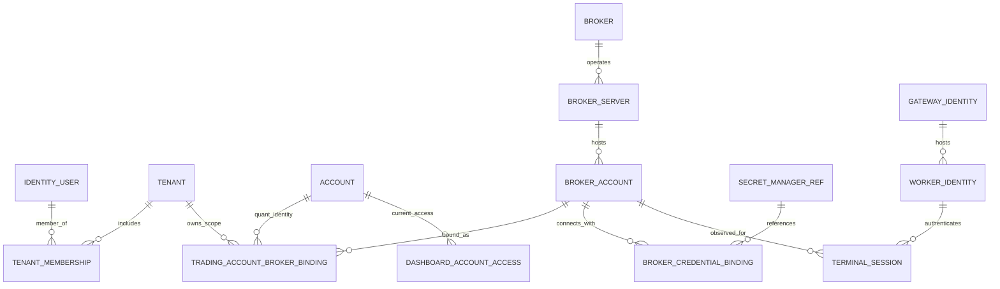
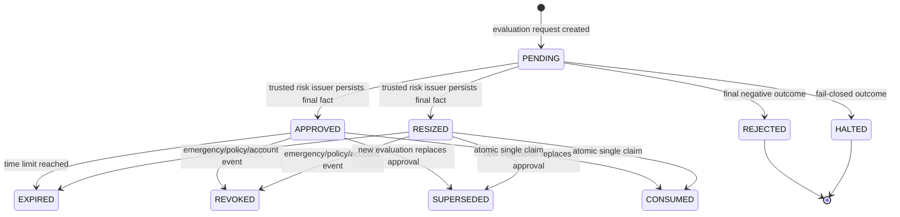
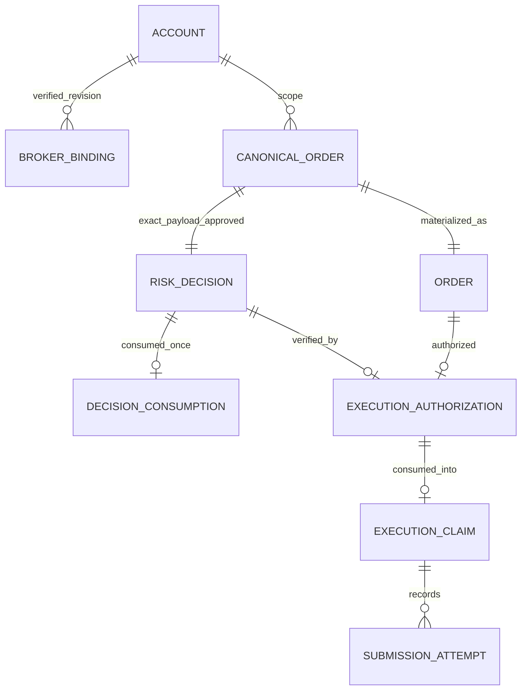
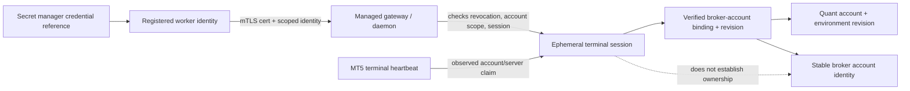

# QOS-021A-E3A — Trusted Broker Identity & Immutable Risk Decision Architecture

**Status:** Investigation complete; recommendations are proposed and require approval.
**Authorization:** Read-only architecture investigation; this report is the sole authorized new file.
**Repository:** `/Users/olaoluwatunmise/event-driven-trading-rs`
**Branch / HEAD:** `main` / `f6446dd33dc74a86ede9064f35aef2ec082a1c59`

## 1. Executive result

**VERIFIED:** Quant OS has account, user, environment-verification, risk-decision, order, authorization and execution-claim records. Its current execution-authorization migration enforces several useful same-account relationships, but broker and server identity are non-empty strings rather than references to authoritative records. The runtime's MT5 TLS principal is a host-configured certificate fingerprint plus terminal/server/account allowlist; it is not durably joined to a Quant trading account or broker-account ownership record.

**VERIFIED:** Risk evaluation produces a public, constructible `RiskDecision` enum. Persistence stores a JSON copy in `risk_decisions`, but `insert_decision` returns no decision ID. The runtime persists the decision and then creates a simulation order from the in-memory enum. No database invariant shown here guarantees that a durable decision approves the exact order subsequently created. The base `orders` model has no stop-loss/take-profit fields, while `TradeIntent` does.

**RECOMMENDATION:** Add a dedicated broker registry and verified account binding, separate from generic `venues`; separate stable broker-account identity from replaceable terminal/worker sessions and credential references. Make risk approval a durable immutable record created only by the risk decision service. Bind it to a versioned canonical order payload digest, account/broker binding revisions, environment revision, policy revision, input evidence, and one client-order identity. Keep mutable lifecycle/consumption in a separate table. Let the coordinator verify and consume an existing decision; it must never create risk approval.

**NOT VERIFIED:** Product decisions remain open for tenant ownership semantics, whether one broker account may back multiple Quant accounts, supported order/protection semantics, risk-state freshness policy, and canonical instrument/server normalization. This report does not mark the proposed ADRs accepted.

No application code, migration, database, Docker resource, process, service, broker connection, or trading capability was changed or exercised. One report was created as authorized.

## 2. Repository identity and preservation evidence

Read-only preflight commands:

```text
pwd
 git rev-parse --show-toplevel
 git branch --show-current
 git rev-parse HEAD
 git status --porcelain=v1 --untracked-files=all
 git status --short --ignored
```

Results: root is `/Users/olaoluwatunmise/event-driven-trading-rs`; branch is `main`; HEAD is `f6446dd33dc74a86ede9064f35aef2ec082a1c59`, matching the directive. The complete porcelain listing at the start of investigation appears in §19. Existing staged, unstaged, deleted, untracked and ignored material was left untouched. In particular, existing E2/E1 reports and the three untracked E2 migrations were not edited. The E2 report identifies its implementation and migration checks; this assignment did not rerun tests, migrations, database checks or runtime commands.

The only created file is this report. Final status is recorded in §20.

## 3. E2 preflight findings

**VERIFIED from source and E2 report:** E2 added explicit account environment provenance and an optimistic revision guard in account verification. The migration keeps legacy accounts unclassified/unverified rather than treating legacy values as proof. E2 added `execution_authorizations` and `execution_claims`, including owner/account, order/account/client-order, and risk-decision/account foreign-key relationships. The authorization includes a canonical SHA-256 field and risk decision ID.

**VERIFIED:** E2 stores `broker_id` and `broker_server_id` as checked nonempty `TEXT`; there is no authoritative registry FK. This was an acknowledged interim limitation in `docs/QOS-021A-E2_ACCOUNT_ENVIRONMENT_AND_MIGRATION_FOUNDATION.md`.

**VERIFIED:** Claims are unique on `(account_id, client_order_id)`. Authorization nonce is unique. Claim states include `CLAIMED`, `SUBMITTING`, `ACKNOWLEDGED`, `REJECTED`, `UNKNOWN`, and `RECONCILIATION_REQUIRED`. `submission_attempt_id` is unique but there is no attempt-history table in this migration. The schema alone does not implement transaction locking, authorization consumption, transport dispatch, or broker reconciliation.

**LIMIT:** The E2 report was read as a repository artifact. Its prior run evidence was not independently re-executed in this read-only phase.

## 4. Current-state entity and relationship inventory

| Entity | Existing identity/relationship | Finding |
|---|---|---|
| `venues` | Text PK; type/name/enabled; account has `venue_id` FK | Generic execution venue; no broker or server hierarchy. |
| `accounts` | Text PK; type/status/venue; environment plus verification/revision from E2 | Quant-owned trading configuration record. Broker account identity is not present in core account row. |
| `identity_users` | Text PK; email unique; active; password hash | User identity table; not itself a tenant/org model. |
| `dashboard_account_access` | `(owner_id, account_id)` PK; account FK; role | Access grants. `owner_id` is text and the table has no FK to `identity_users`; access visibility is not broker ownership proof. E2 authorization adds user/access FKs. |
| `risk_profiles` | Text PK, mutable `policy_json` | Existing profile can be updated in `ensure_strategy_graph`; no immutable policy revision/digest is modeled here. |
| `trade_intents` | Intent/strategy/deployment/instrument/side and target, entry, SL/TP | Strategy intent, not final broker order. |
| `risk_decisions` | BIGSERIAL; intent/account; type/quantity/reason/JSON/time | Persisted outcome, but no immutable trigger/role boundary; repository returns `()`, not ID. |
| `orders` / domain `Order` | Account, venue, client ID, instrument, side/type/TIF/qty/optional price and lifecycle | Global unique client ID in base migration; no risk decision, broker binding, environment revision or SL/TP columns in base model. |
| `execution_authorizations` | E2 owner/account/broker strings/environment/revision/order/hash/client ID/risk ID/nonce/state/times | Relationally binds some identities but broker strings are not registered identities and the hash has no canonicalization-version column. |
| `execution_claims` | E2 account/client ID unique and linked to auth/order | Durable claim aggregate and reconciliation states; no append-only attempts table. |
| MT5 principal | Leaf-certificate SHA-256, terminal ID, server, allowed account strings | Runtime allowlist configuration; no durable foreign-key mapping to `accounts` or broker registry. |
| MT5 snapshot | Account/terminal/server strings, sequence, JSON snapshot | Latest market-data snapshot; strings are not FKs to verified broker identity. |
| Credential abstraction | No broker credential-reference/secret-store binding found in inspected bridge/account/execution schema | **NOT VERIFIED / absent in inspected scope.** Identity API has password-hash and refresh-token handling; it is not broker credential management. |

Relevant sources include `migrations/20260306000001_init.sql`, `migrations/20261106000002_identity.sql`, `migrations/20261107000002_dashboard_account_access.sql`, `migrations/20261111000002_account_environment_provenance.sql`, `migrations/20261111000003_execution_authorizations_and_claims.sql`, `crates/domain/src/account.rs`, `risk.rs`, `trade_intent.rs`, `order.rs`, and `crates/persistence/src/repos/risk.rs`.

### 4.1 Current MT5 trust behavior

**VERIFIED:** `Mt5TransportConfig::from_pem_files` constructs TLS 1.3 mutual TLS with a configured client CA, then requires the exact client leaf-certificate SHA-256 fingerprint to map to a nonempty configured principal. The principal requires terminal ID, server and allowed account strings. First application frame must be a heartbeat whose account, terminal and server match the principal. Later frames must use an allowlisted account. Outbound transport writes are blocked until heartbeat validation and still check the allowed account.

This is a useful workload/session admission control. It proves possession of a CA-trusted client private key and correspondence to a host-side allowlist entry. It does **not**, by itself, prove that the broker account is owned/controlled by a given EdgeNest owner or that the account claim reported by the terminal is independently verified by the broker. Persisted identity binding and onboarding evidence are missing.

**VERIFIED:** Current `dispatch_submit` returns an error stating dispatch is disabled pending verified environment and durable authorization. Thus code contains a deny-all guard; no broker execution is authorized by this finding.

### 4.2 Ownership and access

`identity_users` represents users. `dashboard_account_access` represents access role for an account. The historical migration explicitly says old accounts are not automatically granted to users. The current tables do not model a first-class tenant, organization, tenant membership, or broker-account ownership transfer. Do not interpret dashboard role `owner` as proof of legal/business ownership of the external broker account. A future SaaS tenant boundary needs its own product and schema decision.

## 5. Broker identity architecture alternatives

### Option A — Extend `venues`

**Advantages:** Minimal first migration; account already references a venue; can reuse venue enabled/name/type.

**Risks:** A venue is an execution destination/type abstraction, while broker, server, broker account, terminal and transport are distinct concepts. Encoding server-specific accounts in venue rows conflates provider capability with external identity. It makes one broker with multiple servers, one server with many accounts, server renames/migrations, and terminal replacement difficult to represent without overloaded columns or duplicated venues. It still does not solve credential/session identity.

**Assessment:** Reject as the source of truth. Preserve `venue_id` for execution adapter routing/capability. A broker/provider can optionally map to a venue through an explicit association later.

### Option B — Dedicated broker registry

**Advantages:** Correct hierarchy and FKs; supports multiple brokers, servers and accounts; account/server reassignments are explicit and auditable; stable broker account is independent of terminal; clean SaaS isolation path; credentials can be excluded from core identity rows.

**Risks:** More schema and onboarding workflow; legacy accounts cannot be auto-mapped; external account identifier handling needs privacy and uniqueness design; current owner model remains incomplete.

**Assessment:** Recommend, paired with Option C connection/session separation.

### Option C — Provider/account connection model

**Advantages:** Models runtime connectivity, credential rotation, gateway assignment and terminal sessions; supports multiple provider implementations and reconnects without changing stable business identity.

**Risks:** If used alone, a connection becomes the de facto account identity and terminal replacement/account movement becomes ambiguous. Credential references and sessions have different lifetimes from broker account identity.

**Assessment:** Do not use alone. Use as an explicit adjunct to the dedicated broker registry. Keep connection/session records separate from stable account ownership.

## 6. Recommended broker/server/account model

**PROPOSED:** Add an independently keyed registry. Names below are conceptual, not approved table names.

1. `brokers`: stable `broker_id`, canonical code, display label, lifecycle status, audit timestamps. A broker record is the business/provider identity, not a connection.
2. `broker_servers`: stable `broker_server_id`, `broker_id` FK `RESTRICT`, canonical server key, display name, environment class where known, status and audit. Unique `(broker_id, normalized_server_key)`. Do not assume a server display string is globally unique or immutable.
3. `broker_accounts`: stable internal ID, `broker_server_id` FK, external account identifier protected for lookup (prefer keyed HMAC lookup token plus separately access-controlled/encrypted display/reference when needed), account lifecycle/status, verification evidence, timestamps. Unique `(broker_server_id, account_lookup_hmac)`. Never use an unsalted hash for a low-entropy account number. HMAC key lives outside database and rotation needs versioned key identifiers/dual lookup migration.
4. `trading_account_broker_bindings`: a versioned, audited association from Quant `accounts.id` to one verified `broker_accounts.id`, with status, verification actor/time/method/evidence reference, revision, effective interval and revocation reason. Enforce at most one active binding per Quant account. Whether multiple Quant accounts may map to the same broker account is an explicit product choice; safest default for initial live capability is one active Quant account per external broker account, unless intentional sharing/portfolio partitioning is specified. Access grants remain separate.
5. `broker_connection_profiles` or `broker_credential_bindings`: references to a secret manager/KMS object (identifier/version only), provider, scope, status, revision and rotation metadata. No secret value in ordinary relational tables or logs. A credential reference is not ownership proof.
6. `gateway_identities` and `worker_identities`: stable workload IDs, certificate serial/fingerprint, allowed gateway/account scopes, status/revision, issue/revoke times. Store only public certificate identity metadata, never private keys.
7. `terminal_sessions`: ephemeral connection/session ID; worker/gateway ID; terminal ID; broker server/account binding revision observed; authenticated connection and heartbeat times; sequence/generation; state/close reason. Session is subordinate evidence; it never becomes permanent account identity.

### 6.1 Uniqueness and ownership semantics

- Broker account numbers may collide across brokers and servers. Scope uniqueness to the canonical broker-server plus protected external account identifier.
- A server change is a new/reverified server binding, not an in-place textual substitution. Broker change creates a new broker-account identity and requires explicit account reassociation review.
- A terminal restart/replacement creates a new session/workload certificate lifecycle; it does not change the stable broker account.
- `owner_id`/tenant authority must be obtained through an authenticated server-side principal and a future explicit tenant membership/account entitlement model. Never trust owner/account/broker IDs supplied by an untrusted caller without checking persisted access and authorization policy.
- Do not auto-map legacy records from labels, account type, market data text, or E2 broker strings. Keep them `UNVERIFIED` until verified through an approved onboarding process.

## 7. Identity lifecycle and trust model

### 7.1 Lifecycle proposal

1. **Broker/server onboarding:** provision stable records through reviewed administration; normalize canonical key under a documented provider rule; set active only after independent source verification.
2. **Broker account registration:** capture identifier through controlled enrollment. Protect lookup/display data; record source and evidence reference. No credentials in account row.
3. **Quant account binding:** select a specific existing Quant account and broker account; require correct owner/tenant entitlement, account status, explicit environment and current environment revision; verify account/server identity and record actor, timestamp, method, evidence reference and binding revision.
4. **Gateway/worker enrollment:** issue a workload identity scoped to an approved gateway and a finite account set; install private key in OS/service secret storage; register public certificate fingerprint/serial and status. Authenticate the worker with mTLS and authorize the principal against persisted active scope.
5. **Terminal session:** gateway establishes mTLS; service binds session to the configured principal; terminal heartbeat reports identity; compare against persisted binding and independent verification data. Reject mismatch and record a security event. Do not accept client-claimed account/server as the authority by itself.
6. **Credential rotation:** create new secret-manager version and workload credential; verify new connection; revoke old credential/certificate and sessions. Increment relevant connection/credential revision. Pending authorizations tied to a credential/session scope are invalidated at consumption.
7. **Terminal restart/replacement:** new session ID and heartbeat sequence; existing broker account binding remains if identity evidence matches. Revoke old session. Do not transfer authority solely because terminal ID text is reused.
8. **Disconnect/revoke:** revoke binding or workload identity; terminate/deny sessions; invalidate unconsumed grants and claims not yet submitted; preserve consumed/unknown records for reconciliation.
9. **Ownership transfer:** block new grants, resolve all claims, require administrator-approved transfer and external account control verification, then update entitlement/binding history under a new revision. Never cascade-delete audit evidence.
10. **Environment change/reverification:** E2 account environment revision increases; all prior authorizations fail revision equality and must be newly risk-evaluated/authorized.

### 7.2 Trust boundaries

- **User/tenant identity:** authenticated identity service and server-side entitlement checks.
- **Broker ownership:** onboarding/verification evidence tied to stable broker-account registry and Quant account binding.
- **Gateway/workload identity:** mTLS client certificate authenticates a process/workload to the daemon; registry status/scope authorizes it.
- **Terminal identity:** session claim plus validated heartbeat; helpful telemetry, not cryptographic proof unless terminal protocol itself supplies a verifiable trust factor.
- **Credential reference:** secret manager identity/version controls broker login capability; never infer account ownership only from possession of a credential.
- **Execution authorization:** durable, short-lived, single-use grant bound to current revisions and exact order hash.

### 7.3 Existing configuration mapping

Current `Mt5TransportPrincipal` is an in-memory host allowlist of certificate fingerprint, terminal ID, server and allowed account strings. Future configuration should resolve a certificate to a persisted workload identity; that identity should be authorized for a gateway and specific active broker-account binding. A connection may observe multiple accounts only if product, protocol and isolation requirements explicitly allow it. Prefer one account scope per isolated worker/session at first. A long-lived process must refresh/recheck revocation before every authorization, not cache an unbounded allowlist.

## 8. Risk engine and decision producer analysis

**VERIFIED:** `RiskDecision` is a public enum: `Approved { quantity }`, `Resized`, `Rejected`, `Halted`; any crate caller can construct the value. `NewOrderRequest` accepts it directly. `validated_quantity` checks executable outcome and positive quantity, not that the value came from an authoritative evaluation or persisted record.

**VERIFIED:** `TradingRuntime::execute_intent_inner` builds a `RiskRequest` from intent, account state, configured policy, time, exposure and session; evaluates the risk engine; publishes the result; persists it through `save_risk_decision`; then creates an order for executable decisions. Persistence returns `Result<()>`; the generated ID is not available to the order creation path. Sizing audit snapshots are stored separately and not linked to the risk row by a risk decision ID.

**VERIFIED:** `risk_profiles.policy_json` can be updated on conflict by `ensure_strategy_graph`; there is no immutable policy version/digest in the core migration. A reference to the profile ID cannot reproduce the policy if it is changed later.

**RECOMMENDATION:** Only a trusted risk-evaluation service/issuer should persist an approved decision after evaluating authoritative inputs. The writer should atomically capture the exact serialized input snapshot or durable immutable references plus digest, policy snapshot/digest/version, decision outcome/quantity, evaluation time, producer build/config identity, account/binding/environment revisions, canonical order v1 hash and expiry. The returned decision ID is opaque and must be read back/verified by the coordinator. A coordinator must not accept a caller-created `RiskDecision` as authority or issue approval on its own.

Implementation options for issuer authority: crate-private constructor plus dedicated persistence API/capability boundary within a trusted service; database role grants that permit insert but deny update/delete; append-only trigger as defense in depth; separate role for migrations. Rust visibility alone is not a security boundary against database credentials. Avoid a general SQL role used by arbitrary app components for both risk insert and mutation.

## 9. Immutable risk-decision architecture

### 9.1 Decision evidence record

**PROPOSED:** immutable decision row with at least:

- `risk_decision_id` stable UUID or project-standard ID; if using UUIDv7, approve and lock encoding before adoption.
- owner/tenant principal and `account_id`.
- broker-account binding ID and binding revision, broker/server IDs, environment value/revision.
- trade-intent, deployment, strategy IDs/version, client-order ID.
- canonicalization version and digest; optionally encrypted/controlled canonical payload snapshot for audit/reverification.
- immutable outcome (`APPROVED`, `RESIZED`, `REJECTED`, `HALTED`) and approved quantity/reason code(s).
- immutable risk policy ID, policy version and policy digest, plus policy snapshot or content-addressed immutable object reference with retention guarantee.
- input snapshot digest and either full immutable input snapshot or immutable references with content digest: account state/equity, current exposure/positions, market quote and timestamp, instrument specifications/mapping revision, session/time constraints, applicable limits.
- evaluated/expiry timestamps, decision producer identity and application build/config version, source evidence IDs.

A digest alone does not preserve evidence if the source payload is later deleted or changed. Require stored snapshot or immutable, durable, versioned object references and verify digest on read. Do not leak sensitive account data to logs.

### 9.2 Immutability and lifecycle split

Store decision facts in append-only `risk_decisions`; store state changes in separate `risk_decision_lifecycle_events` and/or a current `risk_decision_consumptions` row. Grant application role `INSERT/SELECT` only on decision facts; deny `UPDATE/DELETE`; migration owner remains privileged and audited. A trigger blocks accidental mutation but is not protection from a database owner/superuser. Corrections append a superseding/revoking event and reference the old decision; never rewrite history.

Do not put mutable `PENDING` in the final decision facts table. If evaluation is asynchronous, model a separate request/job lifecycle. A final outcome is immutable at insertion.

### 9.3 Lifecycle semantics

- **PENDING:** evaluation request state only; cannot authorize.
- **APPROVED / RESIZED:** immutable final outcome, executable only for the exact canonical payload and stated approved quantity, subject to active lifecycle and current revision checks.
- **REJECTED / HALTED:** immutable final negative outcome; never executable.
- **ACTIVE:** lifecycle projection/event means a valid unconsumed approval before expiry; derived from immutable decision plus events and authoritative current state.
- **EXPIRED:** expiry has passed; cannot be consumed.
- **SUPERSEDED:** newer risk decision replaces it; old remains auditable and unusable.
- **REVOKED:** explicit emergency/policy/account action; reason and actor recorded.
- **CONSUMED:** atomically associated with one durable execution claim/client-order ID. Consumption does not mean broker accepted or filled the order.

A decision authorizes at most one immutable order payload and one client-order identity. If any execution-relevant order field changes, create a new client-order ID and rerun risk evaluation. Whether a single intent may generate multiple distinct child orders needs explicit product semantics; safest initial policy: one approved decision per one order.

## 10. Canonical order schema and hashing rules

### 10.1 Payload content

**PROPOSED:** define a domain-specific `CanonicalOrderV1` containing only immutable execution intent and context, not mutable order lifecycle fields. Include:

- format/domain tag and canonicalization version;
- owner/tenant ID; Quant account ID; broker-account ID, broker/server IDs and binding revision;
- environment and environment revision;
- instrument ID plus instrument provider mapping/specification revision and exact symbol identity;
- strategy/deployment/trade-intent identity and version where applicable;
- client-order ID;
- side, order type, time-in-force;
- quantity;
- order-type-specific price/execution constraints;
- stop-loss/take-profit plus explicit bracket/OCO/protection semantics and trigger source;
- reference quote/snapshot ID and freshness/price collar/slippage limit for market orders where applicable;
- contract/currency/unit semantics required to interpret quantities/prices.

Exclude generated database order ID if the same canonical decision must be tied before order insert; bind the eventual order row with a unique FK and compare its canonical projection. Exclude status, fills, timestamps after approval, broker response, and display labels. Never omit a field that can change executable exposure.

### 10.2 Required-field policy by order type

Market order: price may be absent only if a bounded execution rule is present (for example max slippage/price collar and a fresh reference quote with expiry); otherwise risk cannot evaluate price risk deterministically. Limit order: positive limit price required. Stop/stop-limit orders require trigger/limit semantics and trigger source. Bracket protection requires explicit stop-loss/take-profit levels, relationship to entry, and whether protection is broker-hosted or platform-managed. No defaults based on omitted/null fields. Current `Order` domain type only carries optional price and does not carry SL/TP; expanding order semantics is a prerequisite to production coordinator approval.

### 10.3 Deterministic serialization and digest

Do not hash arbitrary `serde_json` output. Define an explicit binary encoding with fixed field order, field tags, explicit presence/null marker, fixed enum numeric codes, and length-prefixed UTF-8 identifiers. Decimal values are exact base-10 canonical strings: no exponent, no leading plus/zeros, normalized trailing fractional zeroes, zero always `0`; reject negative zero, NaN and infinity (Decimal domain already avoids float). Validate against instrument tick/lot precision and store the exact normalized string. Version enum codes permanently; never use Rust debug names or implicit enum serialization.

Digest definition:

```text
SHA-256(UTF8("edgenest:canonical-order:v1\0") || canonical_bytes_v1)
```

Persist version, digest, and (under controlled retention) canonical bytes or canonical field snapshot. Test cross-process golden vectors and field mutation sensitivity. A future v2 serializer must not reinterpret old v1 records; verifier dispatches by stored version. Changing a field, account binding revision, environment revision, client-order ID, risk quantity or protection instruction changes the digest and requires a new decision.

**OPEN PRODUCT DECISION:** canonical broker symbol normalization and external instrument identity mapping must be defined per broker and versioned. Do not normalize symbols by case or punctuation without broker-specific rules.

## 11. Combined authorization binding and consumption

An eventual authorization must reference, not duplicate as trusted caller claims:

1. authenticated owner/tenant entitlement;
2. Quant account ID;
3. active verified broker-account binding ID + revision;
4. broker and server registry IDs;
5. account environment + revision + verified state;
6. active gateway/worker identity + credential/certificate revision and session ID where relevant;
7. immutable risk decision ID and its active lifecycle;
8. immutable order row plus canonicalization version/hash;
9. client-order ID;
10. unique authorization ID/nonce and short expiry;
11. unique durable execution claim and submission-attempt history.

### Issuance checks

- Authenticate owner from server principal, then check explicit entitlement; never accept owner ID as authority from request body.
- Read active account, broker binding, environment verification, gateway/worker scopes and revisions.
- Verify risk decision is final executable and persisted by trusted issuer; account/binding/environment/policy/order digest all match.
- Verify exact order projection and fresh required market/account inputs under product-defined freshness thresholds.
- Use database clock for issued/expiry bounds.
- Issue a short-lived unique grant; no broker dispatch in the issuance transaction.

### Atomic consumption checks

In a single serializable or equivalently locked transaction, lock the authorization, risk lifecycle/consumption row, account, broker binding, environment revision and workload identity scope; recheck all current revisions/status, expiry using database time, exact canonical hash, client-order ID and unique claim. Insert one durable claim and consume/transition the authorization and decision lifecycle atomically. On any mismatch, reject and audit. Database lock/unique constraints prevent concurrent duplicate consumption. The transport send occurs only after commit; never hold a DB transaction across network I/O.

Before the actual send, recheck that the authenticated session remains active and scoped. A DB fencing generation can reject stale internal worker leases, but it cannot guarantee broker-side exactly-once behavior once bytes cross the network. Unknown outcomes must be blocked from resend until reconciliation. Never report write success as broker acceptance.

### Invalidation conditions

At issuance and again at consumption: account disabled/halted; binding inactive or revision changed; broker/server inactive; environment value/revision or verification changed; owner entitlement revoked; worker/gateway/certificate scope revoked or revision changed; credential reference disabled/rotated if authorization is connection-bound; risk decision revoked/expired/superseded/consumed; policy revision changed under chosen freshness policy; order digest or client ID differs; authorization expired/revoked; duplicate/unknown claim exists. Market/account state becoming stale or changing beyond approved freshness/risk tolerances requires reevaluation or fail-closed rejection. Risk policy update semantics must be explicit: conservative initial choice is invalidate any unconsumed decision whose policy revision is no longer current.

## 12. Proposed database schema and migration sequence

All are **PROPOSED**, forward-only, additive first; no migration is authored here.

### Migration A — Broker registry and account binding

- Create `brokers`, `broker_servers`, `broker_accounts`, and `trading_account_broker_bindings` with stable IDs, `RESTRICT` FKs, status checks, revisions, timestamps, verification metadata, partial unique active-binding constraint and lookup indexes.
- Store external account lookup token as keyed HMAC plus key version; keep display identifier encrypted/limited or in a secret/data vault if operationally needed. No credentials.
- Add audit events for create/verify/revoke/rebind. Avoid cascade deletion of identity/evidence.
- Add credential-reference and workload-identity/session tables separately or in a following migration so stable registry can ship without enabling transport.
- Add nullable broker binding FK to new authorization rows or an authorization v2 table. Do not rewrite E2 string broker IDs as if verified.

### Migration B — Immutable policy and risk evidence

- Add immutable `risk_policy_versions` keyed by profile and revision with content digest/snapshot; stop relying on mutable `risk_profiles.policy_json` as historical evidence.
- Add immutable decision evidence table or extend by additive columns/new table. Keep legacy `risk_decisions` readable; do not fabricate policy/input provenance for old rows.
- Add unique opaque decision identity if preserving serial FK compatibility is preferable, and return it from persistence. Add composite account/decision keys needed for same-account references.
- Create separate lifecycle-event/consumption tables with unique one-decision/one-claim constraint.
- Runtime role cannot update/delete immutable rows; migration/owner role is separate.

### Migration C — Canonical order snapshot and authorization v2 binding

- Add a versioned canonical payload record/hash keyed to order/risk decision, with FK and unique `(account_id, client_order_id)` semantics.
- Add risk decision ID, broker binding ID/revision, policy revision, canonicalization version and worker/session scope references to new authorization records.
- Consider a new authorization v2 relation or nullable additive columns until all readers/writers have migrated. Preserve existing E2 rows exactly; mark rows without registry-backed IDs as legacy/unverified and fail closed for any broker dispatch.
- Preserve current execution claim unique key; introduce append-only submission-attempt/outcome records if retry/reconciliation needs full history. `UNKNOWN` never auto-retries.

### Migration D — Validation and constraints after backfill

- Independently verify candidate account mappings; no label/type-based inference. Populate only with evidence and approved actor.
- Audit duplicates/orphans and validate composite FKs/uniqueness. Add constraints `NOT VALID` then validate in controlled windows if supported by PostgreSQL and operationally appropriate; assess locks against exact PostgreSQL version/schema before production.
- Keep unverified legacy rows accessible for audit but ineligible for broker authority.

**Deletion/update policy:** use `ON DELETE RESTRICT` for financial and authorization evidence; append revocation/supersession instead of deleting. Registry display names may be updated with audit, but canonical keys and identities should be immutable or changed through versioned aliases. Binding reassignment is a new revision/history event, not silent update.

## 13. Security and failure analysis

| Threat/failure | Required invariant and prevention | Detection evidence | Recovery |
|---|---|---|---|
| Forged owner identity | Principal comes from authenticated server context; persisted tenant/account entitlement checked | principal, entitlement decision, audit event | Reject; revoke compromised session/token; investigate |
| Cross-account authorization | Composite FKs and transaction checks bind owner/account/order/risk/broker binding | failed FK/check and authorization audit | Fail closed; investigate attempted cross-scope access |
| Broker/server substitution | Registry IDs + verified binding revision; server identity never trusted from free text | heartbeat/server mismatch, binding revision and event | Close session, revoke pending grants, reverify binding |
| Terminal/account mismatch | mTLS workload scope plus independently verified account binding; heartbeat is corroboration only | cert identity, session, observed account/server mismatch | Quarantine session; no dispatch; manual re-enrollment |
| Worker impersonation | TLS CA chain + pinned/revocable cert identity, workload registry, scoped grants, private key isolation | certificate serial/fingerprint, revocation and handshake logs | Revoke cert/session; rotate; investigate key compromise |
| Stale environment revision | Capture verified revision in risk/auth; compare under lock at consumption | expected/current revision mismatch | Invalidate grant and require new evaluation |
| Risk decision substitution | Coordinator loads trusted persisted decision, checks issuer/outcome/account/hash/policy; never trusts enum from caller | decision ID and producer identity audit | Reject; revoke related grants; investigate producer boundary |
| Order payload mutation | Versioned canonical bytes/hash verified at decision, order insert, issue and consume | stored v/hash versus recomputed hash | Reject; create new client ID and rerun risk |
| Duplicate client-order ID | Unique DB constraint scoped by account; one decision/claim; claim state checked | unique violation and duplicate request audit | Return existing state for reconciliation; never blind resend |
| Authorization replay | Unique nonce, single-use state transition and claim in one locked transaction | repeated nonce/consumption event | Reject; retain evidence; revoke principal if suspicious |
| Concurrent grant consumption | Row locks/serializable transaction plus unique decision-consumption and account/client claim constraints | conflict/serialization or uniqueness evidence | One winner; loser reads durable winner state, does not send |
| Credential rotation during grant | Credential/workload revision checked at consumption and pre-send | revision mismatch and secret-manager version audit | Invalidate pending grant; reconnect and reauthorize |
| Broker account reassignment | Versioned binding history; no silent remap; old revision invalidates grants | binding audit/revision transition | Block new sends; reconcile open claims before transfer |
| Unknown submission result | Treat write/timeout as ambiguous; no retry until broker snapshot/order reconciliation | claim `UNKNOWN`/`RECONCILIATION_REQUIRED`, correlation and snapshots | Freeze same client-order dispatch; reconcile; explicit resolution |
| Reconciliation race | Serialize account/client-order resolution and retain raw evidence; idempotent event application | conflicting broker/internal events and version history | Quarantine disagreement; operator review; no state overwrite |
| Stale worker fencing token | Monotonic lease generation checked at internal dispatch; no claim of external exactly-once | generation, worker/session and send attempt IDs | Reject stale process; unknown network result still requires reconciliation |
| DBA/privileged mutation | Separate migration/admin roles, append-only grants/triggers, audit/logical backups | DDL/audit log, digest verification | Incident response and trusted restore; database owner remains a trust root |

These are proposed controls, not tested or proven in this phase.

## 14. Required diagrams

### 14.1 Broker identity ER diagram — proposed, existing links shown



`TENANT`/membership, broker registry, binding, credential, gateway and session entities are proposed. `ACCOUNT` and dashboard access exist. Access is not ownership.

### 14.2 Risk decision lifecycle — proposed



Decision facts remain immutable; transitions after final evaluation are lifecycle events/projections.

### 14.3 Order-risk-authorization binding — proposed



Existing order, authorization and claim records exist; the exact immutable order and decision binding and attempt history are incomplete/proposed.

### 14.4 Worker/gateway trust chain — proposed around existing mTLS



### 14.5 Authorization invalidation sequence — proposed

```mermaid
sequenceDiagram
    participant Admin as Account/risk administrator
    participant DB as Identity + authorization store
    participant Coord as Coordinator
    participant Worker as Scoped worker
    Admin->>DB: Revoke/change binding, environment, policy, credential or worker revision
    DB->>DB: Append audit event; increment revision / revoke lifecycle
    Coord->>DB: Lock and re-read all revisions at consume
    DB-->>Coord: mismatch or inactive authority
    Coord-->>Worker: no dispatch capability
    Note over Coord,Worker: Already-sent/unknown claims remain reconciliation-only
```

### 14.6 Future end-to-end flow — proposed; dispatch remains disabled today

```mermaid
sequenceDiagram
    participant Strategy
    participant Risk as Trusted risk issuer
    participant DB as Durable store
    participant Coord as Authorization coordinator
    participant Gateway as Registered gateway/worker
    participant MT5 as Terminal/provider
    Strategy->>Risk: intent + authoritative account/market/policy snapshots
    Risk->>Risk: evaluate and canonicalize exact order
    Risk->>DB: append immutable decision + evidence
    DB-->>Risk: decision ID
    Risk-->>Coord: decision reference (not caller-supplied approval)
    Coord->>DB: validate identity/revisions; issue short grant
    Gateway->>DB: consume grant atomically; claim once
    DB-->>Gateway: scoped single-use attempt
    Gateway->>MT5: send exact canonical order after commit
    MT5-->>Gateway: accepted/rejected/ambiguous outcome
    Gateway->>DB: append outcome; unknown => reconciliation required
```

## 15. Proposed ADRs (none accepted)

### ADR-E3A-01 — Broker and broker-server identity ownership

- **Context:** Generic `venues` does not represent broker/server hierarchy; E2 authorization stores broker strings.
- **Options:** extend venues; dedicated broker/server registry; connection-only identity.
- **Recommendation:** dedicated `brokers` and `broker_servers`; map execution venue separately where needed.
- **Rationale:** stable provider/server identity, proper FKs and auditable server changes without overloading venue routing.
- **Consequences:** additive registry and onboarding required; legacy strings stay unverified.
- **Migration/security:** create inactive registry first; verified admin onboarding; no guessed backfill; `RESTRICT` FKs and revisioned server keys.
- **Open question:** who may create/canonicalize brokers and server aliases, and what source proves their identity?

### ADR-E3A-02 — Broker account registry and Quant account association

- **Context:** Quant `accounts` and MT5 reported account strings have no authoritative relationship; account number alone is not globally unique.
- **Options:** account number on `accounts`; connection-scoped mapping; dedicated broker account plus versioned binding.
- **Recommendation:** dedicated broker account keyed by broker-server and protected account lookup token; explicit verified binding to Quant account.
- **Rationale:** handles multiple accounts/server, account moves, terminal replacement and audit; connection is replaceable.
- **Consequences:** enrollment, evidence retention and privacy controls required. Keep `dashboard_account_access` separate from broker ownership.
- **Migration/security:** no bulk inference; legacy remains unverified; consider one-to-one active mapping initially.
- **Open question:** may one external broker account map to multiple Quant accounts/tenants, and what is the external ownership verification procedure?

### ADR-E3A-03 — Immutable risk-decision record

- **Context:** public enum is forgeable by callers; DB insert loses ID and stores mutable JSON; policy and input evidence can change.
- **Options:** trust current in-memory enum; immutable DB fact plus lifecycle; signed token without durable evidence.
- **Recommendation:** trusted issuer writes append-only decision with policy/input/order evidence and returns ID; coordinator verifies persisted record.
- **Rationale:** durable source of truth, replayable provenance and clear authority separation.
- **Consequences:** role separation, evidence retention, new API and migration required; legacy decisions cannot be upgraded as proven.
- **Migration/security:** DB permissions and triggers; no UPDATE/DELETE by runtime role; hash is not a substitute for stored evidence.
- **Open question:** snapshot retention/privacy, immutable object store, producer attestation and decision ID format.

### ADR-E3A-04 — Canonical order payload and hashing

- **Context:** E2 contains a hash field without canonicalization version; order serialization could drift and domain order omits SL/TP.
- **Options:** serde JSON bytes; generic canonical JSON; explicit versioned domain encoding.
- **Recommendation:** explicit versioned binary field encoding, exact decimal strings and domain-separated SHA-256; store canonicalization version and reproducible evidence.
- **Rationale:** stable deterministic hash independent of serializer implementation.
- **Consequences:** protocol specification and golden-vector compatibility become permanent obligations; order schema must include all executable semantics.
- **Migration/security:** additive v1 canonical snapshot and verifier; never reinterpret old hashes; reject changed payloads.
- **Open question:** exact field list per provider/order type, symbol mapping and price collar semantics.

### ADR-E3A-05 — Risk decision consumption and lifecycle

- **Context:** E2 authorization/claim schema has states but no coordinator semantics or durable consumption path.
- **Options:** mutate risk row state; encode lifecycle on authorization only; immutable decision plus separate lifecycle/claim.
- **Recommendation:** immutable fact plus append-only lifecycle/consumption, one decision to one canonical order/claim, atomic unique claim and locked consumption.
- **Rationale:** separates evidence from operations; prevents replay/race; preserves unknown outcomes.
- **Consequences:** additional state projection and transaction logic; no automatic retry for unknown send.
- **Migration/security:** unique decision consumption and account/client claim; attempt history append-only; network call outside DB transaction.
- **Open question:** one-intent/many-child order support; timeouts and policy-approved freshness windows.

### ADR-E3A-06 — Authorization invalidation rules

- **Context:** E2 captures environment revision but not authoritative broker binding, workload identity or policy revision.
- **Options:** validate only at issuance; recheck only selected state; recheck every authority revision at atomic consumption and before send.
- **Recommendation:** validate at issue and atomically consume, rechecking current account/broker/environment/entitlement/worker/credential/policy/order/decision state; session check immediately before send.
- **Rationale:** shortens stale-authority windows and makes revocation effective before an unsent dispatch.
- **Consequences:** lock ordering and availability requirements; changes invalidate grants; external send still cannot be exactly-once.
- **Migration/security:** revision columns and event audit; unknown outcomes require reconciliation; fencing is internal and not broker-side.
- **Open question:** freshness tolerance for changed exposure/market data; what changes can revoke in-flight versus unconsumed work?

## 16. Open questions requiring explicit approval

1. Is the SaaS customer boundary a tenant/organization, an individual identity user, or both? Who may grant/revoke account access and transfer ownership?
2. Can an external broker account be shared by multiple Quant accounts or tenants? If yes, what allocation and risk isolation semantics prevent cross-tenant exposure?
3. What independent evidence verifies broker account control, broker, and server? May read-only account metadata be used, and what are the required human approval steps?
4. Which provider is production-authoritative for identity confirmation (MT5 EA heartbeat, official Windows provider, broker statement/API, managed gateway attestation)? What is corroborating versus authoritative evidence?
5. What is the normalized broker/server identifier rule, and how are aliases or broker server migrations represented?
6. Which order types are in scope first? Define stop orders, brackets/OCO, broker-hosted versus platform-managed protection, market slippage/price collar, and cancellation/replace semantics.
7. Define policy version lifecycle and invalidation: does any risk-policy revision revoke every unconsumed decision, or only materially relevant changed limits?
8. Define freshness tolerances for equity, exposure, market quote, instrument specification and session; should any intervening position/fill invalidate approval?
9. What data may be persisted for reproducible risk evidence, how long is it retained, and which fields require encryption or restricted access?
10. Which ID convention is canonical for decisions, broker identities, sessions, grants and attempts? Are UUIDs required or should existing text IDs/BIGSERIALs remain?
11. What submission status can provider/EA prove, what constitutes ambiguous outcome, and who resolves reconciliation discrepancies?
12. Is managed Windows gateway the only future MT5 production deployment, and how many terminals/accounts may one workload identity serve?

Until these decisions are approved and enforceable, broker dispatch remains fail-closed.

## 17. Implementation sequencing recommendation

This is a dependency order, not authorization to execute.

1. **Approve domain decisions and threat invariants.** Resolve §§16.1–16.7 at minimum; freeze ID, owner and broker normalization semantics.
2. **Broker/server registry and verification workflow.** Add registry, protected account identity, revisioned Quant account binding and audit. Do not activate dispatch. Tests cover duplicate/collision, rebind, account mismatch, legacy-unverified behavior and deletion restrictions.
3. **Workload/credential-reference/session model.** Register gateway/worker certificate identities and revocation scope; keep secret values in external secret manager. Prove mTLS identity maps to exactly authorized account scope and terminal session mismatch fails closed.
4. **Immutable risk policy versions and decision evidence.** Make policy snapshot/version immutable; issuer evaluates authoritative inputs, canonical order and returns persisted decision ID. Separate mutable lifecycle. Add DB role tests for denied UPDATE/DELETE and reproducibility tests.
5. **Canonical order v1 contract and domain alignment.** Add complete execution semantics (including protection and market constraints) to domain/persistence; golden vectors, cross-version verification and mutation tests. Do not enable live transport.
6. **Authorization schema integration.** Add registry FKs/revisions, decision ID, canonicalization version and lifecycle/consumption links additively; retain E2 string fields/rows for audit, mark legacy unverified and do not perform destructive backfill.
7. **Coordinator and durable claims.** It loads the authoritative decision; checks all revisions; atomically consumes once and creates claim; adds append-only attempt/outcome history. Fake transport tests concurrency, replay, expiry, stale revisions, mutation, unknown outcomes and reconciliation races.
8. **Read-only staging rehearsal and recovery evidence.** Fresh-install and restored-copy rehearsal on isolated disposable database, verify migration checksums, locking/constraints, restore proof and role privileges. No staging mutation without separate authorization.
9. **Gateway/provider conformance and operational controls.** Test certificate rotation, revocation, session replacement, health, outage and multi-account isolation with execution disabled.
10. **Separate release gate.** Any broker capability, runtime cutover or real dispatch requires its own explicit authorization after test evidence and operator rollback plan.

Phases 1–3 can be developed independently of risk issuer changes, but live authorization cannot. Canonical order schema (5) depends on product order semantics. Authorization schema integration (6) depends on stable registry IDs and canonical contract. Coordinator (7) depends on all identity and decision invariants. Deployment comes only after all conformance gates.

## 18. Exact files and commands inspected

### Files inspected (read-only)

- `migrations/20260306000001_init.sql`
- `migrations/20261027000001_sizing_decision_audits.sql` (referenced in E2 report/schema search)
- `migrations/20261027000002_mt5_bridge_order_keys.sql` (referenced in E2 report/schema search)
- `migrations/20261106000002_identity.sql`
- `migrations/20261107000002_dashboard_account_access.sql`
- `migrations/20261111000002_account_environment_provenance.sql`
- `migrations/20261111000003_execution_authorizations_and_claims.sql`
- `crates/domain/src/account.rs`
- `crates/domain/src/risk.rs`
- `crates/domain/src/trade_intent.rs`
- `crates/domain/src/order.rs`
- `crates/execution-engine/src/request.rs`
- `crates/trading-runtime/src/pipeline.rs`
- `crates/persistence/src/repos/risk.rs`
- `crates/intent-bridge/src/mt5_transport.rs`
- `crates/intent-bridge/src/mt5_runtime.rs`
- `crates/intent-bridge/src/mt5_v1.rs` (identity references)
- `crates/intent-bridge/src/bin/mt5-bridge-daemon.rs` (principal construction references)
- `crates/persistence/src/repos/mod.rs` (save-risk call reference)
- `docs/QOS-021A-E2_ACCOUNT_ENVIRONMENT_AND_MIGRATION_FOUNDATION.md`
- QOS-021A-E3A directive attachment.

### Commands run

```text
pwd
git rev-parse --show-toplevel
git branch --show-current
git rev-parse HEAD
git status --porcelain=v1 --untracked-files=all
git status --short --ignored
cat <QOS-021A-E3A directive attachment>
nl -ba <listed migration/source files> | sed -n '<ranges>'
rg -n '<identity/risk/credential/schema terms>' crates migrations docs
```

No `cargo`, Python test, database, Docker, network, process, LaunchAgent, broker or MT5 runtime command was run. No test or build was run.

## 19. Exact Git preservation evidence before report creation

Pre-investigation `git status --porcelain=v1 --untracked-files=all`:

```text
 M .github/workflows/ci.yml
M  Cargo.lock
 M crates/account-engine/src/simulated.rs
 M crates/domain/src/account.rs
 M crates/domain/src/lib.rs
 M crates/domain/tests/phase1_architecture.rs
 M crates/event-trading/src/execution/fill.rs
 M crates/execution-engine/src/oms.rs
 M crates/intent-bridge/src/lib.rs
 M crates/intent-bridge/src/mt5_runtime.rs
 M crates/intent-bridge/src/mt5_transport.rs
 M crates/intent-bridge/src/mt5_v1.rs
 M crates/intent-bridge/tests/mt5_transport_mtls.rs
 M crates/journal-api/src/dashboard.rs
 M crates/persistence/src/pool.rs
 M crates/persistence/src/repos/accounts.rs
 M crates/persistence/src/repos/mod.rs
 M crates/persistence/tests/survive_restart.rs
 M crates/reconciliation/tests/venue_vs_internal.rs
 M crates/trading-runtime/src/multi_account.rs
 M crates/trading-runtime/src/pipeline.rs
 M crates/trading-runtime/src/runtime.rs
 M crates/venue-connectors/src/adapter.rs
 M crates/venue-connectors/src/bridge.rs
 M crates/venue-connectors/src/lib.rs
 M crates/venue-connectors/src/prop.rs
 M crates/venue-connectors/src/simulated.rs
 D crates/venue-connectors/tests/ambiguous_unknown.rs
 D crates/venue-connectors/tests/cancel_confirmation.rs
 M crates/venue-connectors/tests/e2e_pipeline.rs
 D crates/venue-connectors/tests/failure_injection.rs
 M crates/venue-connectors/tests/prop_pipeline.rs
M  docker-compose.yml
?? crates/domain/src/execution_authorization.rs
?? crates/persistence/tests/qos021a_e2_migrations.rs
?? crates/venue-connectors/src/tests/ambiguous_unknown.rs
?? crates/venue-connectors/src/tests/cancel_confirmation.rs
?? crates/venue-connectors/src/tests/failure_injection.rs
?? docs/QOS-020_TEST_INFRASTRUCTURE.md
?? docs/QOS-021A-E1-R1_GENERIC_VENUE_EXECUTION_BOUNDARY.md
?? docs/QOS-021A-E1_EXECUTION_AUTHORIZATION_FOUNDATION.md
?? docs/QOS-021A-E2_ACCOUNT_ENVIRONMENT_AND_MIGRATION_FOUNDATION.md
?? docs/QOS-021A-S_ARCHITECTURE_AND_INFRASTRUCTURE_RECOVERY.md
?? migrations/20261111000001_journal_trading_account_fk_repair.sql
?? migrations/20261111000002_account_environment_provenance.sql
?? migrations/20261111000003_execution_authorizations_and_claims.sql
?? scripts/qos020/docker-compose.qos020.yml
?? scripts/qos020/init/10-qos020-init.sql
?? scripts/qos020/provision.py
?? scripts/qos020/qos020_guard.py
?? scripts/qos020/test_guard.py
?? scripts/traderos-migration/migrate.py.before-http-debug
?? scripts/traderos-migration/migrate.py.debug-backup
```

The separate `git status --short --ignored` also showed pre-existing ignored environments/caches/build output such as `.conda/`, `.pytest_cache/`, `.venv/`, `.vscode/`, adapter caches/egg-info, frontend build/node_modules, migration reports/state, `migration/`, and `target/`. No ignored item was accessed or changed by this investigation beyond status reporting.

## 20. Final Git status and no-runtime-operation confirmation

Final `git status --porcelain=v1 --untracked-files=all` was re-read after report creation. It retained all entries from §19 and added exactly:

```text
?? docs/QOS-021A-E3A_TRUSTED_IDENTITY_AND_IMMUTABLE_RISK_ARCHITECTURE.md
```

No existing staged, unstaged, deleted, untracked or ignored work was modified, staged, unstaged, removed or overwritten. No migration, build, test, database connection/write, Docker command, process/service operation, broker connection, MT5 dispatch, deployment, or trading operation occurred.

## 21. Classification summary

- **VERIFIED:** Current schema/source facts and deny-all MT5 dispatch behavior cited above.
- **PARTIALLY VERIFIED:** E2 preflight claims as recorded in its report; not rerun during E3A.
- **NOT VERIFIED:** External ownership proof, actual deployment credential/session registry, tenant semantics, production gateway enrollment and broker-side account identity assurance.
- **BLOCKED for implementation:** Production broker authorization cannot be defensibly implemented until open product decisions and required authoritative identity/evidence sources are approved.
