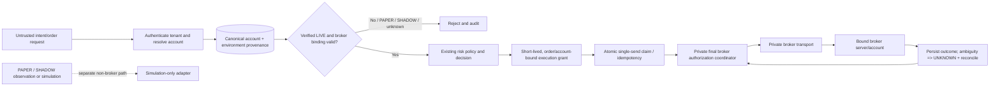

# QOS-021A-S — Execution Authorization Architecture and QOS-020 Recovery

**Date:** 2026-11-11  
**Repository:** `/Users/olaoluwatunmise/event-driven-trading-rs`  
**Branch / HEAD:** `main` / `f6446dd33dc74a86ede9064f35aef2ec082a1c59`  
**Scope:** Read-only architecture and infrastructure investigation. No QOS-021A implementation, migrations, application-data changes, staging access, or broker execution.

## 1. Executive summary

The original QOS-020 PostgreSQL instance is recoverable. Docker inspection confirmed its recorded container, project, network, volume, pinned image, and Linux ARM64 platform. The existing guard passed against that exact instance, and its negative tests reject the protected staging endpoint without connecting to it. No replacement instance was provisioned.

The current workspace has no live broker order adapter. The generic trading pipeline can submit to a `VenueAdapter`, but the only production implementations are the in-process simulated venue and a Prop adapter whose live mode returns `NotImplemented`. The MT5 daemon is read-only. The MT5 library does contain a separate submit-permit/transport path, but no production executable calls it; its current worker/EA side is also read-only. This means there is no current broker submission boundary to authorize. Before any live adapter or MT5 submit flow is introduced, a trusted final authorization boundary must be implemented and made unavoidable for every broker-capable adapter.

**Execution architecture readiness: PARTIALLY READY.** The existing path and missing controls are identified, and a design is proposed below. The current architecture cannot enforce trusted environment/provenance or guarantee all future broker sends pass one final authorization point.

**Test infrastructure readiness: READY.** The original QOS-020 instance passes identity validation.

**Overall QOS-021A readiness: NOT READY.** The authorization requires both workstreams to be ready before implementation authorization. No implementation authorization is implied by this investigation.

## 2. Initial and final Git state; preservation

Initial and final branch/HEAD were `main` / `f6446dd33dc74a86ede9064f35aef2ec082a1c59`. Initial status:

```text
 M .github/workflows/ci.yml
M  Cargo.lock
 M crates/intent-bridge/src/mt5_v1.rs
M  docker-compose.yml
?? docs/QOS-020_TEST_INFRASTRUCTURE.md
?? scripts/qos020/
?? scripts/traderos-migration/migrate.py.before-http-debug
?? scripts/traderos-migration/migrate.py.debug-backup
```

Those pre-existing staged, unstaged, and untracked changes were preserved. The only tracked repository file created by this phase is this report. No files were reset, stashed, cleaned, committed, or pushed.

Protected SHA-256 values:

| File | SHA-256 |
|---|---|
| `Cargo.lock` | `0114a3432961bae1989c479073e12ea84df6507c27debda84e832d950e35e0a0` |
| `docker-compose.yml` | `0a761eb4c42c5d9b72cd9f642ea7ef8411fc70106205b2acbcb2e90ef4789866` |
| `crates/intent-bridge/src/mt5_v1.rs` | `514c6bd0b7da5846e558dfc6e221e1e5192472e4b359f7200d493f67dbeddcb2` |
| `.github/workflows/ci.yml` | `7eb6c98d3518e05e97497f2e8ec1163d6ca90488556af870098f3cd2cbcbd1f6` |
| `docs/QOS-020_TEST_INFRASTRUCTURE.md` | `a439e0ca37f4d863a381c523bf3b3ba3548a2eab0d678b0e947a3b946a167bbb` |
| Both migration backups | `3156c8bb1c26ea24baa9aa3eaaa35426753d350ce61f3d1801950a41a36b402a` |

## 3. Complete order-submission call graph

### Current in-process trading runtime

```text
TradeIntent
  -> TradingRuntime::execute_intent / execute_intent_inner
  -> RiskEngine evaluate (RiskDecision)
  -> if executable: venue_connectors::submit_approved_order
  -> ExecutionEngine::create_order (OMS)
  -> ExecutionEngine::mark_submitted
  -> VenueAdapter::submit_order
  -> adapter acknowledgement / fills / OMS state updates
```

Evidence:

- `crates/trading-runtime/src/pipeline.rs:212-290` stores intent, obtains account state, evaluates risk, and returns without submission if the decision is not executable.
- `crates/trading-runtime/src/pipeline.rs:318-347` calls `submit_approved_order` after risk approval.
- `crates/venue-connectors/src/bridge.rs:16-37` creates and submits through the adapter. `crates/venue-connectors/src/adapter.rs:11-24` defines the public trait.
- `crates/execution-engine/src/oms.rs` creates an order and records a risk decision, but it does not resolve the persisted account record or environment.

### MT5 library submit path

```text
Mt5BridgeRuntime::dispatch_submit
  -> prepare_submit
     -> Mt5SessionGate::authorize_submit (bound account/readiness/capabilities)
     -> frame validation
     -> persistence::claim_mt5_order (stable client-order key)
     -> New => Mt5DispatchPermit; Existing => ReconcileRequired
  -> permit.execute_over_transport(self-consuming permit)
     -> re-check session and frame immediately before send
     -> AuthenticatedMt5Connection::write_frame
     -> read correlated submit outcome
     -> persist accepted/rejected/unknown; degrade on ambiguous result
```

Evidence: `crates/intent-bridge/src/mt5_runtime.rs:375-410`; `crates/intent-bridge/src/mt5_dispatch.rs:29-90, 180-211`; `crates/intent-bridge/src/mt5_v1.rs:118-140`.

This is a real library-level transport path, not just a data type. However, workspace search found `dispatch_submit` called only by `crates/intent-bridge/tests/mt5_transport_mtls.rs:653` and by its own method definition. `crates/intent-bridge/src/bin/mt5-bridge-daemon.rs:1-5, 161-185` invokes reconciliation only and explicitly has no order-submit or cancel command. It does not call `dispatch_submit`.

The checked-in `adapters/mt5-python/mql5/QuantOSReadOnlyProvider.mq5:1-5` is explicitly read-only and has no `OrderSend`/`CTrade` calls. Python adapter tests likewise forbid order submission calls. Thus the current MT5 runtime is not a broker execution path.

## 4. Current final broker boundary and bypass analysis

1. **Component that currently sends an order to a real broker:** none found in this workspace. No real broker adapter implementation was found.
2. **Adapters:** `SimulatedVenue` in `crates/venue-connectors/src/simulated.rs` simulates fills. `PropVenue` in `crates/venue-connectors/src/prop.rs` is an in-process simulator; `PropVenueMode::Live` is explicitly blocked by `ensure_paper()` with `NotImplemented` (`:36-43, 77-83, 141-148`). Test-only adapters wrap simulation or return synthetic errors.
3. **MT5 daemon:** read-only, confirmed by code and its runtime loop.
4. **`mt5_dispatch.rs`:** implements a public library capability path and test transport scenario, but has no production caller. Its peer-side EA/worker is read-only.
5. **Permit issuance:** `prepare_submit` calls the authenticated session gate, validates the frame, then atomically claims the account/client-order key; only `Mt5OrderClaim::New` issues a permit.
6. **Permit consumption:** `execute_over_transport(self, ...)` consumes the permit value, revalidates session/frame, sends, then persists the response. A permit cannot be cloned, but public methods also allow callers to invoke `record_outcome` or `record_ambiguous_transport_failure` instead of the send method.
7. **Can an adapter be invoked without the permit?** Yes. `VenueAdapter::submit_order` is public and direct calls exist in adapter tests. `submit_approved_order` is a convention/wrapper, not an enforced trait boundary. The MT5 `AuthenticatedMt5Connection::write_frame` is public (`mt5_transport.rs:539`), and possession of the connection allows writing a frame without `Mt5DispatchPermit`.
8. **Direct adapter invocation:** yes. The trait is public; callers can invoke any implementation directly, bypassing OMS and risk wrapper.
9. **Retry/replay:** the normal OMS wrapper suppresses an already-created client ID and MT5 storage rejects an existing durable claim by requiring reconciliation. Those are useful controls within their paths, but they do not guard direct adapter invocation. MT5’s unique account/client key protects duplicate claims, not a bypassing direct transport write.
10. **Account identity:** `TradingRuntime` binds an account ID from `RuntimeConfig` and uses it for the risk request and order request (`pipeline.rs:253-256, 326-345`). MT5 binds terminal/server/account to a configured certificate principal and then to session frames (`mt5-bridge-daemon.rs:88-99`, `mt5_session.rs:57-66`).
11. **Binding immutability:** MT5’s session gate checks that frames use the established account; the transport principal includes allowed accounts, terminal ID, and server. The in-process order uses the runtime-configured account ID. Neither binding proves that the persisted account is verified for a particular environment.
12. **Substitution/TOCTOU:** the current runtime has no DB environment/authorization check to race against. For a future live path, resolving environment before a later send would create a TOCTOU risk unless authorization is bound to the account, order, risk result, and broker identity and atomically consumed at the final dispatcher.
13. **Duplicate/concurrent sends:** MT5 order claims use a durable account/client-order key and an atomic database insert; duplicate claims return reconcile-only. Permit execution serializes connection access through a mutex in `Mt5BridgeRuntime`. That path is not wired to production daemon; generic `VenueAdapter` direct calls lack a universal single-send gate.
14. **Single authoritative final authorization point:** no. The generic adapter trait is directly callable, while the MT5 transport connection exposes public frame writing. No trusted environment/provenance context is enforced at either boundary.

## 5. Trusted execution authorization design

### Trust inputs

- **Untrusted request:** intent/order data, caller-supplied account/environment strings, and client idempotency key. These may select a requested account/order but cannot establish ownership or environment verification.
- **Persisted identity:** account ID, tenant/owner binding, broker/server, and account type loaded from the authoritative database. Owner scope comes from authenticated identity claims, not request payload.
- **Verified environment:** persisted environment plus provenance state (who/what verified it, when, and evidence reference). Legacy defaulted PAPER is explicitly unverified until reviewed.
- **Risk authorization:** immutable reference to an approved risk decision covering account, order/intent, sizing inputs, policy version, and evaluation time.
- **Execution authorization:** short-lived, server-generated single-use grant binding tenant, account, broker/server, environment verification revision, order/client key, risk-decision ID, authorization ID, issue time, expiry, and nonce.
- **Broker credentials:** resolved only inside the broker adapter/secret boundary; never embedded in the grant, order JSON, or logs.

### Proposed final path

All broker adapters should be private implementation details behind one execution coordinator. The public adapter interface must not expose a directly callable broker send method. The coordinator should load/lock the canonical account row, verify tenant/account/broker identity and environment provenance, reject anything except verified LIVE, validate the current risk and execution authorization, and atomically claim a unique `(account_id, client_order_id)` send key and consume a short-lived authorization before invoking a private broker transport. A consumed or expired grant cannot authorize another order. A lost response transitions to UNKNOWN and requires reconciliation, never resend.

The database transaction cannot remain open across an external broker call as a guarantee of atomicity. Use a durable single-send claim/outbox state transition before transport, plus a per-account dispatcher lock/lease and broker idempotency key where supported. If the lease expires after an ambiguous send, reconciliation must establish broker truth before any retry. Broker identity (server/account) must be rechecked against both the authenticated terminal principal and persisted account binding immediately before send.

PAPER and SHADOW routes should accept only simulated/observation interfaces. They must not be representable as broker-capable adapter grants. Environment alone never grants LIVE access; risk authorization, owner access, account verification, adapter capability, and execution grant are all required.



### Required changes by crate/module

- `domain`: distinct `AccountEnvironment`, verification/provenance state, and account identity binding; make unclassified explicit.
- `persistence`: forward migrations; account/environment/provenance reads and writes; tenant/account lookup; durable authorization and single-send claim storage; transactional claim APIs.
- `identity-api` / `journal-api`: explicit environment creation, no fabricated PAPER, tenant-scoped account access, unverified-state representation. Keep Journal accounts distinct from OMS accounts.
- `trading-runtime` / `risk-engine`: select only verified eligible accounts; bind risk decisions to canonical account and order data; reject unclassified accounts before decision/execution.
- `execution-engine`: carry stable order and risk-decision identity; do not itself authorize a broker send.
- `venue-connectors`: make broker transport invocation private behind coordinator; separate simulation-only interface; prevent direct concrete broker adapter calls from bypassing the coordinator.
- `intent-bridge`: production MT5 submit flow, if later approved, must resolve persisted account provenance and require the execution grant in `dispatch_submit`; restrict `write_frame` so non-coordinator code cannot emit submit frames.
- `api-gateway` / deployment: one migration job and dedicated DDL credentials; runtime service credentials without DDL; authenticated ownership and signing/verification configuration.

## 6. Security, concurrency, compatibility, and required tests

### Risks and unresolved architecture

- Current `VenueAdapter` is public and has a direct `submit_order` method; enforcement solely in `submit_approved_order` is bypassable.
- Current account repository writes an account but does not read full `Account` records or environment; environment is not in `Account` domain.
- Current risk evaluation uses in-memory account state and does not bind verified environment to its decision.
- MT5 `write_frame` is public and the runtime dispatch method is public. The production daemon does not call it, but future integration must not treat session readiness as risk or environment authorization.
- No real broker adapter means LIVE submission behavior cannot yet be tested end-to-end. Do not create one as part of QOS-021A.
- Existing account environment values may have come from the historical PAPER default. Their provenance must remain separately represented; migration must not infer verification.
- API compatibility: dashboard consumers must understand `environment: null`/unverified state; no legacy fallback to PAPER.
- SQLx migration changes still require immutable history, core-first bootstrap tests, forward-only FK repair tests, and fail-closed history preflight.

### Required tests before implementation can be considered safe

- Compile-time/API tests prove broker adapter send cannot be invoked without coordinator capability.
- Runtime rejection tests for missing, unverified, stale, and mismatched tenant/account/server/environment provenance.
- PAPER and SHADOW grants cannot reach broker transport; simulation paths remain isolated.
- LIVE rejects missing, stale, replayed, wrong-account, wrong-order, wrong-risk-decision, and wrong-server grants.
- Concurrent same-key submissions produce one claim/send; replay and ambiguous outcome require reconciliation.
- Adapter direct invocation and raw `write_frame` bypass tests fail by construction or are inaccessible outside the coordinator.
- Account/environment persistence, provenance, dashboard serialization, and legacy classification tests.
- Migration bootstrap and all supported migration-history/FK catalog tests against guarded QOS-020 PostgreSQL only.
- End-to-end broker adapter test remains unavailable until a real broker adapter is separately authorized and provided; use a transport fake to test coordinator ordering without issuing broker orders.

## 7. QOS-020 original instance inspection and guard evidence

The initial unprivileged Docker call was denied access to the Docker socket by the local sandbox. A read-only elevated inspection was then authorized and succeeded. No lifecycle command was run.

Verified original manifest identity:

| Resource | Verified value |
|---|---|
| Run / project | `20261110-230504-ffb59dfd0ab4` / `qos020-integration-20261110-230504-ffb59dfd0ab4` |
| Container ID / name | `f6f4f45ee58930f5059845a58a023e3f2c2643e1770a0c8ef6f47cb596a0ad82` / `qos020-integration-20261110-230504-ffb59dfd0ab4-postgres-1` |
| State / health | running / healthy |
| Network | `qos020-integration-net-20261110-230504-ffb59dfd0ab4` (only the expected container attached) |
| Volume | `qos020_it_20261110_230504_ffb59dfd0ab4` |
| Image | `postgres@sha256:57c72fd2a128e416c7fcc499958864df5301e940bca0a56f58fddf30ffc07777` |
| Image ID / platform | `sha256:7e7dbab8d3b431a20793a6d99cb5a6bc84e44914309917f1bf5589a7568cdefd` / `linux/arm64` |
| Endpoint | `127.0.0.1:51462` |
| Database / role | `qos020_test_master` / `qos020_sqlx` |

Exact identity guard result:

```text
QOS-020 identity verified: project=qos020-integration-20261110-230504-ffb59dfd0ab4 run_id=20261110-230504-ffb59dfd0ab4 host=127.0.0.1 port=51462 database=qos020_test_master role=qos020_sqlx
exit_code=0
```

Guard negative/positive tests:

```text
Ran 19 tests in 0.001s
OK
```

The tests include `test_protected_port_15543_rejected`, `test_unknown_endpoint_rejected`, `test_wrong_container_rejected`, and valid registered-instance acceptance. The protected port test uses guard validation logic; it did not connect to `127.0.0.1:15543`.

**Recovery decision:** Original run recovered and verified. No new run was provisioned. The original instance remains available and unchanged. The protected MT5 staging project, network, container, and volume were not inspected or modified in this phase; no database migration, schema/data query beyond QOS-020 identity guard checks, or recovery-dump access occurred.

## 8. Exact commands and outcomes

Commands were run from the repository root:

```text
git status --short; git rev-parse --show-toplevel; git branch --show-current; git rev-parse HEAD
Outcome: expected main/HEAD and pre-existing dirty/untracked status recorded.

shasum -a 256 Cargo.lock docker-compose.yml crates/intent-bridge/src/mt5_v1.rs .github/workflows/ci.yml docs/QOS-020_TEST_INFRASTRUCTURE.md scripts/traderos-migration/migrate.py.before-http-debug scripts/traderos-migration/migrate.py.debug-backup
Outcome: protected hashes recorded above.

docker info / docker inspect / docker network inspect / docker volume inspect / docker image inspect (read-only, elevated)
Outcome: Engine 27.5.1, Linux aarch64; original resource identities matched manifest.

python3 scripts/qos020/qos020_guard.py --manifest <original manifest> --secrets-dir <original secrets dir> --lane integration-test --run-id 20261110-230504-ffb59dfd0ab4
Outcome: QOS-020 identity verified; exit 0.

python3 scripts/qos020/test_guard.py
Outcome: 19 tests passed, including protected 15543 rejection; no protected endpoint connection.

rg -n "submit_order|send_order|order_send|single_send|SingleSend|dispatch|VenueAdapter|authorize_submit|prepare_submit|execute_over_transport|..." crates adapters
Outcome: full workspace execution symbols and candidate callsites identified; no real broker API call found.
```

No Rust build, SQLx migration test, application test, or QOS-021A source change was performed. The only repository file created is this report.

## 9. Readiness decisions

### Execution architecture readiness: PARTIALLY READY

The order paths, adapter implementations, MT5 permit lifecycle, identity binding, and bypasses are identified. A trusted-context flow and test plan are defined. It is not ready to implement safely until the broker boundary is made structurally unavoidable, environment provenance is loaded from persistence, and dispatch authorization is single-use and account/order/risk/broker-bound. There is currently no real broker adapter to validate as an end-to-end target.

### Test infrastructure readiness: READY

Verified run: `20261110-230504-ffb59dfd0ab4`. Its exact container, network, volume, pinned image/platform, PostgreSQL version, loopback endpoint, database identity, role privilege profile, and QOS-020 marker passed the guard. Protected endpoint rejection tests passed without connecting to staging.

### Overall QOS-021A readiness: NOT READY

Both workstreams must be ready before recommending implementation authorization. Infrastructure is ready; execution authorization architecture is only partially ready. This phase authorizes no QOS-021A implementation.

## 10. Remaining blockers

1. Approve and implement one non-bypassable final broker authorization coordinator before adding any real broker submission implementation.
2. Make broker adapter invocation and raw MT5 submit-frame writes inaccessible without a short-lived, persisted-context-bound execution capability.
3. Integrate verified account environment/provenance and tenant/account/server identity with risk authorization and durable single-send claims.
4. Preserve PAPER/SHADOW simulation-only routing and require existing independent LIVE risk/authorization controls.
5. Verify migration bootstrap, state preflight, provenance schema, and FK repair in QOS-020 after implementation authorization.
6. Define how a future broker adapter is tested without enabling real trading; end-to-end live broker testing requires a separate authorization and non-production broker account.

Stop here. QOS-021A implementation and QOS-021B have not begun.
